# 新能源电力与设备原理 · 01 电工基础

> 适用岗位：HaierEnergy / 新能源 HEMS 产品经理  
> 建议掌握程度：深入理解  
> 工作关联度：极高  
> 版本：图文兼容版（公式与示意图均为 PNG；图片使用相对路径）  
> 文档定位：电工基础模块系统学习资料（通用原理；教学示例不代表实际设备实现）

---

## 一、模块定位与知识结构

### 1.1 为什么 HEMS 产品经理必须理解电工基础

HEMS（Home Energy Management System，家庭能源管理系统）表面上涉及电站监控、能流展示、设备控制、运行策略与数据统计，但它描述和控制的对象是遵循电路规律、能量守恒及设备物理约束的电力系统。

家庭能源系统中可能存在光伏组件、逆变器、储能电池、家庭负载、电网和电表。电工基础能帮助产品经理：

1. **理解电力数据**：明确电压、电流、功率和电能的含义。
2. **理解能量流动**：辨别能量从哪里产生、流向哪里，以及流向变化的原因。
3. **理解设备边界**：知道功率、电压、电流及温度限制的物理依据。
4. **理解异常现象**：区分物理异常、测量偏差、通信问题和软件计算问题。
5. **进行技术判断**：理解研发和硬件工程师提出的技术方案及适用条件。

### 1.2 知识结构

```text
电工基础
├─ 01 电学基本物理量：电荷、电压、电流、电阻
├─ 02 电路与基本定律：电路、串并联、欧姆定律、基尔霍夫定律
├─ 03 电功率与电能：W、kW、Wh、kWh、损耗、效率
├─ 04 直流与交流：DC、AC、频率、有效值、相位
├─ 05 交流功率：有功、无功、视在功率、功率因数
├─ 06 单相与三相：相电压、线电压、三相功率、不平衡
├─ 07 电气元件与电能变换：RLC、阻抗、电磁感应、变压器
└─ 08 测量与安全：电表、CT、功率方向、接地、漏电和保护
      ↓
看懂电力参数 → 理解电路关系 → 判断功率流向 → 识别约束与异常
```

### 1.3 学习边界

本模块重点掌握电路与电力测量的通用原理，尤其是 HEMS 经常使用的功率、电量、相位、三相与设备约束。复杂电磁场方程、保护整定、施工设计及电力电子器件详细设计仅说明其原理与边界，不作为本模块的深入计算目标。

---

## 二、必要基础：建立电的物理概念

### 2.1 电荷、电流与电能

电荷（Electric Charge）是物质的电学属性。金属导体中部分电子可移动，外部电场使其产生定向漂移，形成电流。

- **电荷**：带电粒子具有的属性，单位 C（库仑）。
- **电流**：单位时间通过某截面的净电荷量，单位 A（安培）。
- **电能**：电力系统所传递、储存或转换的能量，单位 J、Wh、kWh 等。

电荷并不等于电能。电荷在回路中运动时可以将电能从电源传递到负载。

### 2.2 电压、电流、电阻

| 概念 | 符号 | 单位 | 物理含义 |
|---|---|---|---|
| 电压 Voltage | U | V（伏特） | 两点之间的电势差，单位电荷对应的电势能变化 |
| 电流 Current | I | A（安培） | 电荷通过截面的速率，有参考方向 |
| 电阻 Resistance | R | Ω（欧姆） | 元件对电流的阻碍以及电阻性耗能特性 |

**平均电流：**

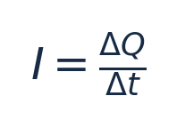

其中 `\Delta Q` 单位 C，`\Delta t` 单位 s。瞬时电流为 `i=dq/dt`。

**电压和电势能变化：**

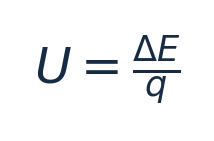

其中 `\Delta E` 单位 J，`q` 单位 C；具体符号与转移方向有关。

**欧姆定律：**

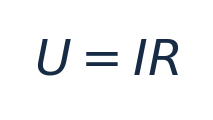

适用于满足欧姆型关系的电阻元件。逆变器、电池、开关电源和光伏组件不能整体简化成一个不变的电阻。

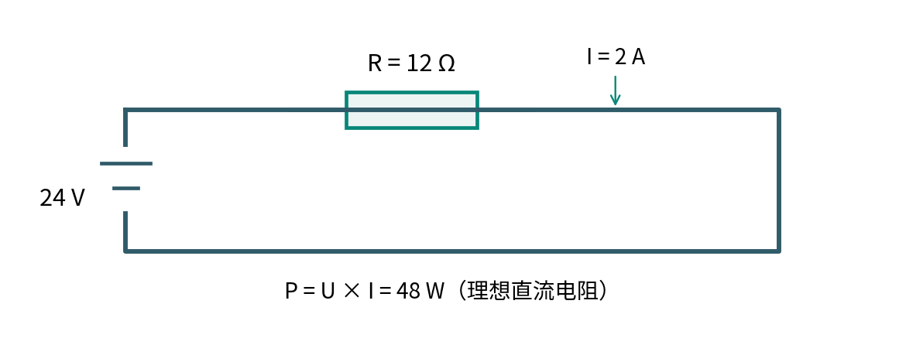

**教学示例**：24 V 电源接 12 Ω 理想电阻，电流 `I=24/12=2 A`，功率 `P=24×2=48 W`。在电阻不变时提高电压，电流上升，电阻发热功率按电压平方增长。

### 2.3 导体、绝缘体与半导体

| 类型 | 特点 | 典型用途 |
|---|---|---|
| 导体 | 电荷比较容易移动 | 铜导线、母排、端子 |
| 绝缘体 | 规定条件下电导率很低 | 电缆绝缘层、设备绝缘结构 |
| 半导体 | 导电特性可受电场、材料结构等控制 | 二极管、MOSFET、IGBT |

绝缘不表示任何条件下都不能导电。超过绝缘设计边界可能发生漏电、击穿和电弧。

---

## 三、核心知识详解

### 3.1 电路的组成与基本定律

#### 3.1.1 电路的构成

基本电路通常包含电源、导电通路、负载，以及必要的开关与保护元件。电路正常工作需要符合其连接和控制条件。

**有电压不代表一定有电流**：开路电池端子仍可能有电压，但无外部持续负载电流。**有电流也不代表全部电流都对应有用有功功率**：可能存在无功交换、损耗或辅助功耗。

| 状态 | 含义 | 可能现象 |
|---|---|---|
| 正常通路 | 电流沿预期路径流动 | 电压、电流处于工作范围 |
| 开路 | 预期导电路径断开 | 该支路电流接近零 |
| 短路 | 非预期低阻抗通路 | 故障电流可能很大 |
| 接触不良 | 接触电阻异常或间歇断开 | 局部发热、电压波动 |
| 漏电 | 电流沿非预期绝缘路径流动 | 可能触发保护或带来触电风险 |

短路电流仍受电源内阻、线路阻抗、电源限流能力和保护装置影响；不同电源的短路响应可能不同。

#### 3.1.2 串联和并联

**串联**：元件流过同一支路电流，端电压分配。

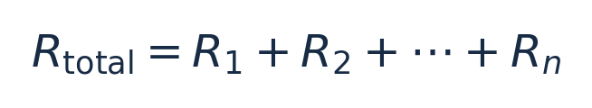

**并联**：支路端电压相同，总电流等于支路电流之和。

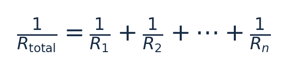

以上为理想电阻网络关系；光伏组件、电芯不是固定电阻，不能直接使用这些公式描述它们的所有工作特性。

#### 3.1.3 基尔霍夫电流定律（KCL）

在适用的集总电路节点模型中，流入电流之和等于流出电流之和：


根本依据是电荷守恒。存在显著电荷积累或高频分布效应时应采用更完整的动态模型。

#### 3.1.4 基尔霍夫电压定律（KVL）

在适用的集总电路模型中，沿闭合回路各电压升降的代数和为零：


若有显著时变磁通，需要正确纳入感应电动势，不能机械使用静态形式。

> **HEMS 关联**：KCL 讲的是电流守恒；能流图一般展示有功功率。不能从电流守恒直接推出所有设备的功率可以不加条件地相加。必须先定义测量端口、方向、功率类型和时间边界。

### 3.2 电功率、电能、损耗与效率

#### 3.2.1 功率

功率表示单位时间能量传递或转换速率。同一端口、参考方向配套时：

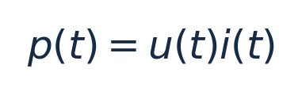

`p` 单位 W，`u` 单位 V，`i` 单位 A。

稳定直流系统：

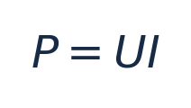

纯电阻：

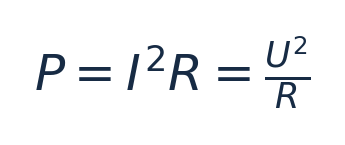

交流系统计算有功功率一般还要考虑相位和波形。

#### 3.2.2 电能

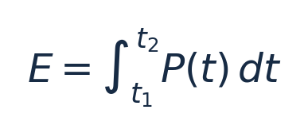

当功率恒定：

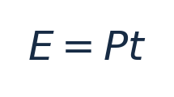

- W、kW 是功率单位，`1 kW=1000 W`。
- Wh、kWh 是电能单位，`1 kWh=1000 Wh`。
- `1 kWh=3.6×10^6 J`。

**示例**：2 kW 负载运行 3 小时，消耗 6 kWh。若负载随时间变化，则必须积分或分时段累计，不能拿某一瞬时值乘以全天小时数。

| 时间段 | 平均功率 | 时长 | 电能 |
|---|---:|---:|---:|
| 00:00—06:00 | 0.3 kW | 6 h | 1.8 kWh |
| 06:00—12:00 | 0.8 kW | 6 h | 4.8 kWh |
| 12:00—18:00 | 1.2 kW | 6 h | 7.2 kWh |
| 18:00—24:00 | 1.5 kW | 6 h | 9.0 kWh |
| 合计 | — | 24 h | **22.8 kWh** |

#### 3.2.3 能量守恒与功率平衡

系统能量守恒可以写为：


所有能量项必须采用一致的统计边界、单位和核算口径。对应的准稳态功率模型为：

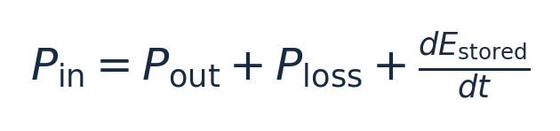

该表达式包含内部储能变化项，比简单认为“输入功率永远等于输出功率”更完整。

#### 3.2.4 损耗

| 损耗类型 | 机理 | 典型位置 |
|---|---|---|
| 电阻损耗 | 电流使导体发热 | 导线、母排、接插件 |
| 半导体导通损耗 | 导通压降或导通电阻 | 逆变器、DC/DC |
| 开关损耗 | 功率器件切换时消耗能量 | 电力电子设备 |
| 磁性损耗 | 绕组电阻、磁芯损耗 | 电感、变压器 |
| 辅助功耗 | 控制、风扇、显示等用电 | 设备内部 |

电阻损耗：


当导线电阻 0.1 Ω，10 A 损耗 10 W，20 A 损耗 40 W。电流加倍，电阻损耗为原来的四倍（电阻不变时）。

#### 3.2.5 转换效率

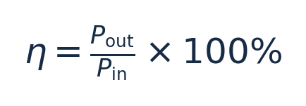

适用于输入输出功率口径对应、稳定运行的比较。示例：逆变器直流输入 5000 W、交流输出有功 4750 W，效率为 95%，其余 250 W 对应损耗及辅助消耗。

效率随电压、负载率、温度等变化；铭牌最大效率不等于每时刻实际效率。

### 3.3 直流、交流、有效值与相位

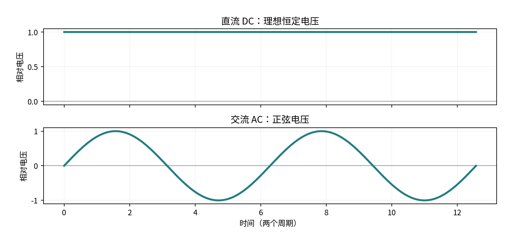

#### 3.3.1 直流电（DC）

直流电流方向不周期性反转。理想恒定直流电压：


现实直流电可以存在纹波或波动，因此“直流”不等于数值永远不变。常见直流场景有电池端口、光伏组件输出端、逆变器直流母线。

#### 3.3.2 交流电（AC）

正弦交流电压模型：

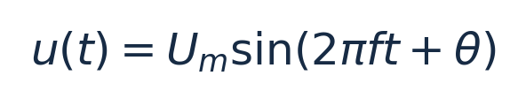

`U_m` 是峰值（V），`f` 是频率（Hz），`t` 是秒，`\theta` 是初相角（rad）。

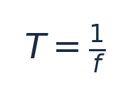

50 Hz 对应周期 20 ms；实际电网频率因地区与供电系统而异。电网频率、功率器件开关频率、设备采样频率和 APP 刷新频率是不同概念。

#### 3.3.3 有效值 RMS

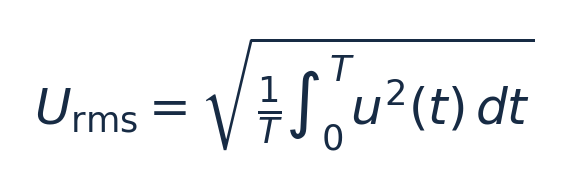

理想正弦波：

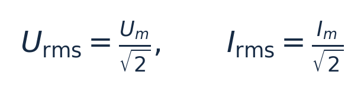

230 V 正弦交流电的峰值约 325.3 V。该根号 2 关系不适用于任意畸变波形。

#### 3.3.4 相位

同频率正弦电压和电流可以有相位差：

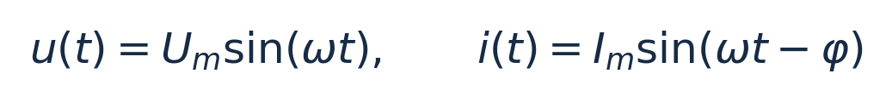

`\omega=2\pi f` 是角频率（rad/s），`φ` 是相位差。按此表达式，`φ>0` 表示电流滞后电压。相位差影响交流有功与无功功率。

### 3.4 有功、无功、视在功率与功率因数

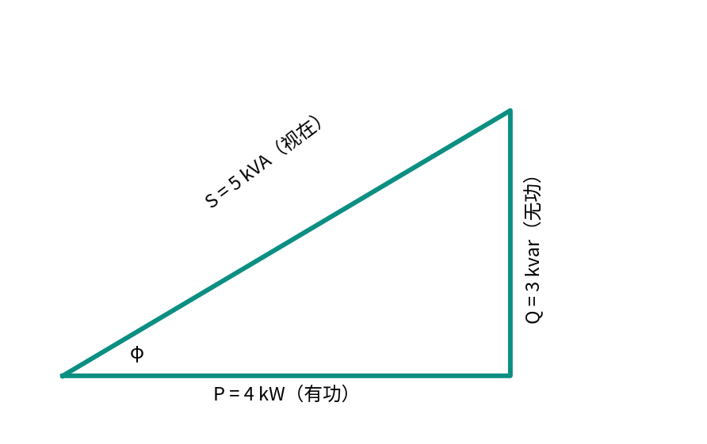

#### 3.4.1 有功功率 P

有功功率是某时间窗口内平均能量传递或转换的速率：

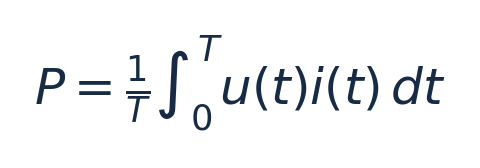

单相正弦稳态：


单位 W、kW。示例：230 V、10 A、功率因数 0.8，对应有功功率 1840 W。

#### 3.4.2 无功功率 Q

在正弦稳态中，电感、电容与电源周期性交换能量：

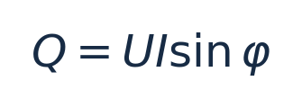

单位 var、kvar。按常见被动符号约定，感性负载吸收正无功，容性负载吸收负无功；实际设备寄存器符号可能不同。无功不是“毫无作用”，它会影响电流、线路容量和电网电压调节。

#### 3.4.3 视在功率 S

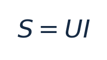

单位 VA、kVA；U、I 均为有效值。它反映交流端口电压和电流的组合容量。VA 不直接等于 W。

在单相正弦稳态经典功率模型下：

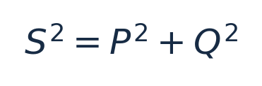

非正弦、谐波和不平衡情形需要使用适用的功率定义，不能无条件套用该三角关系。

#### 3.4.4 功率因数 PF

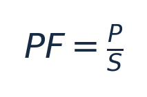

单相正弦稳态：`PF=\cosφ`。功率因数与转换效率不同：前者衡量 P 与 S 的关系，后者衡量输出输入的有用能量转换关系。

| 维度 | 功率因数 PF | 效率 η |
|---|---|---|
| 含义 | 有功/视在功率 | 有用输出/输入 |
| 典型公式 | P/S | Pout/Pin |
| 关注重点 | 交流相位、电流和容量 | 转换损耗 |
| 数值 0.9 的意义 | P 为 S 的 90% | 有用输出为输入的约 90% |

#### 3.4.5 逆变器的有功与无功容量约束

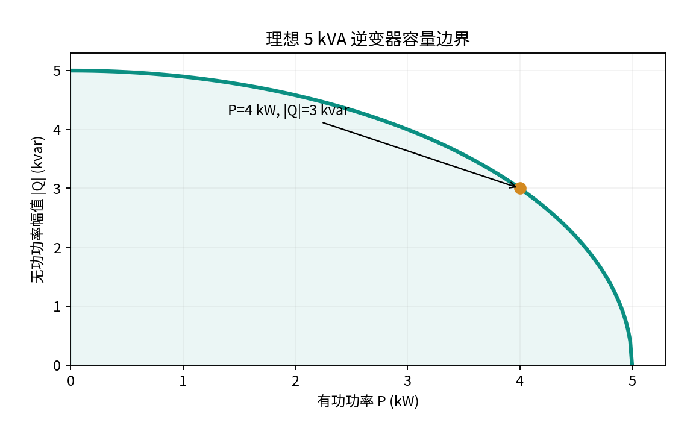

假设逆变器额定视在容量 5 kVA，在理想正弦稳态容量模型中：


若 P=4 kW，则 `|Q|_{\max}=√{25-16}=3 kvar`；P=5 kW 时，该理想容量圆上允许无功幅值为零。

这是**教学模型**。实际设备还可能有热限制、电流限制、P-Q 能力曲线及不同控制优先级，不能据此直接定义产品的可设值范围。

### 3.5 单相、三相与不平衡

#### 3.5.1 单相系统

常见单相配电系统可能包含 L（相线）、N（中性线）、PE（保护接地导体）。不同地区的接线制式及电压并不相同，不宜默认所有地区都是 220/230 V 的 L-N 系统。

#### 3.5.2 三相系统

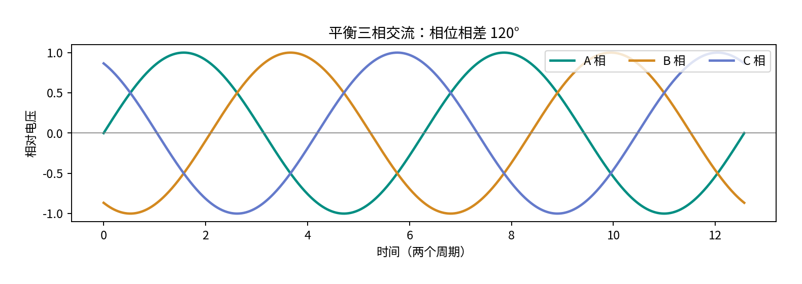

理想对称三相电压相位相差 120°：

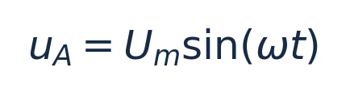

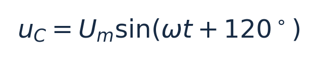

三相适合较大功率输送、三相电机和复杂配电场景。平衡时三相瞬时有功功率之和可保持恒定。

#### 3.5.3 相电压与线电压

- 相电压：通常是相线与中性点之间的电压。
- 线电压：两根相线之间的电压。

对称平衡星形系统：

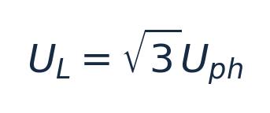

230 V 相电压对应线电压约 398.4 V；400 V 是常见标称值，但非全球通用值。

#### 3.5.4 星形 Y 和三角形 Δ

| 连接 | 电压关系 | 电流关系 |
|---|---|---|
| 平衡星形 Y | `U_L=√3U_{ph}` | `I_L=I_{ph}` |
| 平衡三角形 Δ | `U_L=U_{ph}` | `I_L=√3I_{ph}` |

#### 3.5.5 三相有功功率

平衡三相正弦稳态：

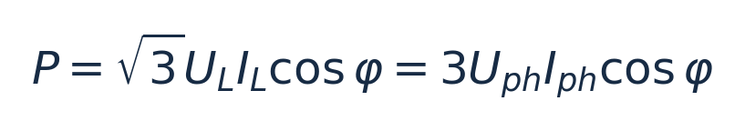

400 V 线电压、10 A 线电流、PF=0.9 时，有功功率约 6.24 kW。

对于不平衡三相，原则上逐相计算：


若各相满足正弦稳态，则：


**三相不平衡示例**：

| 相 | 电压 | 电流 | 假设 PF=1 的有功功率 |
|---|---:|---:|---:|
| A | 230 V | 10 A | 2.30 kW |
| B | 230 V | 3 A | 0.69 kW |
| C | 230 V | 5 A | 1.15 kW |
| 总计 | — | — | 4.14 kW |

三相不平衡可导致某相电流过大、中性线电流和发热风险、设备性能降低等问题。

**一个重要反例**：按“电网流入家庭为正”，三相 P 分别为 +2 kW、−1 kW、−1 kW，总功率为零，但三相并非都没有功率交换。总功率为零不意味着各相均未购电或上网；具体计量结算还取决于电表和当地规则。

### 3.6 电阻、电容、电感与阻抗

#### 3.6.1 电阻 R

理想纯电阻交流负载中，电压电流同相，功率因数为 1，主要将电能转换为热能。

#### 3.6.2 电容 C

电容主要通过电场储能，单位 F：


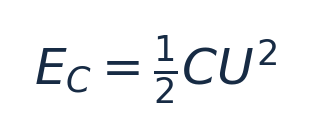
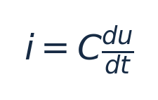

理想正弦稳态下电容电流超前电压 90°。电容用于直流母线平滑、滤波、无功补偿等。理想电容电压不能在有限电流条件下瞬间突变。

#### 3.6.3 电感 L

电感主要通过磁场储能，单位 H：

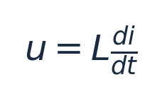
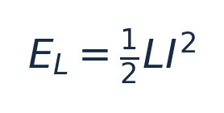

理想正弦稳态下电感电流滞后电压 90°。电感可用于滤波、开关电源能量转换、限制电流变化等。理想电感电流不能在有限电压条件下瞬间突变。

#### 3.6.4 电抗与阻抗

理想电感感抗：

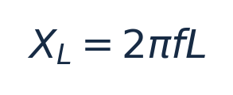

理想电容容抗大小：

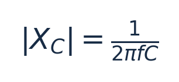

单位均为 Ω。频率越高，感抗越大，容抗越小。

串联 RLC 正弦稳态复阻抗：

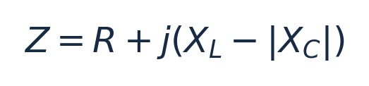
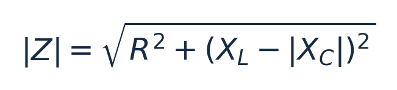

`j` 为虚数单位，用于描述相位。在相量法中：

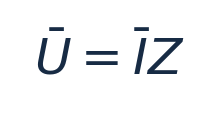

产品经理需要理解滤波、谐振、相位及波形会影响电气运行，不必在本模块深入设计滤波器。

### 3.7 电磁感应、变压器与电能变换

#### 3.7.1 法拉第电磁感应

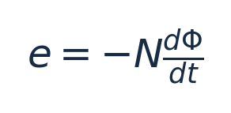

`e` 为感应电动势（V），`N` 为匝数，`\Phi` 为磁通量（Wb）。负号体现楞次定律：感应作用方向反抗引起磁通变化的原因。

#### 3.7.2 理想变压器

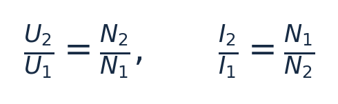

变压器依靠变化磁通耦合传递电能。理想情况下升高电压会伴随电流下降，不会凭空增加功率。例如 230 V 升至 460 V，假设输入 2300 W、功率因数为 1、忽略损耗，则输入 10 A、输出 5 A。

实际变压器存在铁损、铜损和漏磁等限制。

#### 3.7.3 电能变换

| 变换 | 输入 | 输出 | 功能 |
|---|---|---|---|
| AC/DC 整流 | 交流 | 直流 | 交转直 |
| DC/AC 逆变 | 直流 | 交流 | 直转交 |
| DC/DC | 直流 | 直流 | 改变直流电压电流 |
| AC/AC | 交流 | 交流 | 改变交流参数 |

功率电子设备通过开关器件、控制及滤波执行转换。用户设置的输出功率最终仍受物理端口电压、电流、热设计和保护条件限制。

### 3.8 额定参数与电气约束

#### 3.8.1 不同参数的区别

| 概念 | 含义 | 示例 |
|---|---|---|
| 额定值 | 规定条件下声明的运行参数 | 额定功率 5 kW |
| 允许运行范围 | 满足工作要求的参数区间 | 某工作电压范围 |
| 最大允许值 | 特定条件下的极限 | 最大输入电压 |
| 保护阈值 | 触发保护判断的条件 | 过流、过温阈值 |
| 用户设定值 | 期望运行目标 | 输出目标 3 kW |
| 实际测量值 | 真实反馈量 | 实际输出 2.8 kW |

额定值不意味着所有温度、输入电压和功率因数下均能保持该输出；最大有功功率与最大视在功率也可能不同。

#### 3.8.2 多约束共同作用

假设直流端口最大连续电流为 20 A，仅按 `P=UI`：

| 电压 | 电流上限 | 对应功率 |
|---|---:|---:|
| 40 V | 20 A | 800 W |
| 48 V | 20 A | 960 W |
| 60 V | 20 A | 1200 W |

不能由此推断提高电压可无限提高输出；真实设备还有限压、限功率和温度条件。实际值低于用户设定值，还可能与源侧供能不足、其他控制策略、采样差异等有关。

### 3.9 电气测量与电表

#### 3.9.1 常见测量量

| 量 | 符号 | 单位 | 意义 |
|---|---|---|---|
| 电压 | U | V | 指定两点电势差 |
| 电流 | I | A | 电荷流动速率 |
| 有功功率 | P | W/kW | 平均有功传输速率 |
| 无功功率 | Q | var/kvar | 交流储能交换相关功率 |
| 视在功率 | S | VA/kVA | 有效电压乘有效电流 |
| 功率因数 | PF | 无量纲 | P/S |
| 频率 | f | Hz | 波形周期频率 |
| 电能 | E | Wh/kWh | 累计传递能量 |
| 绝缘电阻 | Rins | Ω/MΩ | 绝缘路径阻抗特性中的电阻指标 |

接口只有 `voltage=230` 还不够：应知道电气测量端点、相别、交流有效值或直流值、单位和测量时刻。

#### 3.9.2 电流测量方法

- **分流电阻**：已知电阻上的压降测电流，`I=U_{shunt}/R_{shunt}`。需要考虑发热、共模电压、精度和隔离。
- **电流互感器 CT**：利用交流电磁感应实现电流变换，通常用于交流计量。标称 100:5 的 CT 在规定条件下，一次侧 100 A 对应二次侧 5 A。CT 不天然适合测量稳态直流，二次侧带一次电流时不得随意开路。
- **霍尔电流传感器**：利用磁场影响进行测量，可设计用于直流和交流。

#### 3.9.3 电表数据形成路径

```text
真实电压、电流
    ↓
电压/电流传感器
    ↓
采样与计量算法（RMS、P、Q、方向、电能累计）
    ↓
计量寄存器/数字接口（单位、倍率、符号、状态）
    ↓
上层系统读取、传输和展示
```

实时功率与累计电能不同：某时刻 2.5 kW 不能替代一段时间的电量。两次累计电能 1850.6 kWh、1852.1 kWh，相减得 1.5 kWh，前提是计数器未重置、未溢出、倍率一致且确属同一量。

双向电表可能分别计量正向和反向有功电能，但“正向/反向”必须依据计量参考方向解释，不能假设全世界都将正向定义为购电。

#### 3.9.4 精度、分辨率、采样与上报

- **测量准确度/精度相关指标**：关注结果与被测量值的一致程度；准确度等级、误差限和不确定度是不同概念。
- **分辨率**：可区分的最小变化；显示 0.1 W 不意味着误差小于 0.1 W。
- **采样频率**：测量电路获取波形样本的频率。
- **上报频率**：数据传输到上层的频率。
- **界面刷新频率**：APP 更新显示的频率。

三种“频率”不必相等，上报值还可能经过平均或滤波。时间戳差异会导致各设备瞬时功率短时间不平衡。

#### 3.9.5 电能质量与谐波

| 现象 | 含义 | 可能影响 |
|---|---|---|
| 电压暂降 | 电压短时下降 | 复位、设备中断 |
| 电压暂升 | 电压短时升高 | 过压保护、绝缘应力 |
| 电压中断 | 电压供给中断 | 负载停止 |
| 频率偏差 | 偏离参考频率 | 并网控制及保护 |
| 电压不平衡 | 三相电压不对称 | 三相设备性能下降 |
| 谐波 | 基波整数倍频率分量 | 损耗、发热、干扰 |
| 闪变 | 特定电压波动使光输出产生可感变化 | 照明体验 |

50 Hz 电网的 3 次谐波为 150 Hz，5 次谐波为 250 Hz。实际非线性负载和功率电子系统可产生非正弦电流，简单 `\cosφ` 未必等于完整功率因数。

IEC 61000-4-30:2025 规定 50/60 Hz 系统的多项电能质量测量方法，但不自动给出全球统一的并网限值。

### 3.10 电气安全、接地与保护

#### 3.10.1 电击风险

人体电击风险与电流大小、流经路径、接触持续时间、电流频率与波形、人体和环境阻抗等因素相关。不能只用“电压低”或单个固定电流值判断绝对安全。

#### 3.10.2 典型故障

| 类型 | 物理含义 | 风险 |
|---|---|---|
| 过流 | 超出允许电流 | 发热、导线损坏 |
| 短路 | 非预期低阻抗连接 | 故障电流、电弧、损坏 |
| 过压 | 超出允许电压 | 绝缘及元件损坏 |
| 欠压 | 低于运行条件 | 运行不稳定 |
| 过温 | 超出热边界 | 寿命下降、损坏 |
| 绝缘故障 | 绝缘能力下降 | 电击和火灾风险 |

设备可能采取限流、降额、断开、锁定或条件满足后恢复等措施，但不能假设不同厂商统一采用同一恢复逻辑。

#### 3.10.3 L、N、PE

- L：相线，正常情况下参与电能输送。
- N：中性线，在相应系统中可承担正常工作电流。
- PE：保护接地导体，用于电击防护。

N 与 PE 作用不同，不得任意互换；保护方式还取决于 TN、TT、IT 等接地系统及保护装置配合。

#### 3.10.4 剩余电流保护 RCD

RCD 检测相关带电导体的电流不平衡，从而识别可能的剩余电流并在规定条件下动作。RCD 不一定具有过载或短路保护；不同类型对直流成分及波形的适用性也不同，需结合电源、设备和适用标准选型。

#### 3.10.5 防孤岛基础

非计划孤岛是主电网断电后，分布式电源仍向局部网络供电的状态。普通并网设备通常需要具备符合适用并网要求的防孤岛能力。它不同于经过专门设计的备电或离网供电。

> 是否能在电网停电后继续向家庭负载供电，不只由“有无电池”决定，还与拓扑、电气隔离、逆变器能力、保护与控制条件有关。

#### 3.10.6 用户控制与设备保护

用户设置 4 kW，设备因过温实际降额到 2.5 kW：4 kW 是控制目标，2.5 kW 是实际状态，过温降额是保护或运行约束。软件设置不能绕过物理安全边界。

IEC 61140:2016 提供电击防护基础原则。项目还需按照国家/地区、供电制式、产品类别和现行适用标准判断。本文不构成带电作业或电气安装指导。

### 3.11 功率方向、参考点与符号约定

#### 3.11.1 正负号取决于参考方向

电路理论常用被动符号约定：电流从元件正电压端流入时，`p=ui>0` 表示吸收功率；`p<0` 表示向外释放功率。

但是设备接口可以使用别的符号体系。

**示例：电池实际放电 1000 W**

| 接口定义 | 上报值 |
|---|---:|
| 正值为放电 | +1000 W |
| 正值为电池吸收功率（充电） | −1000 W |

两个数都可能正确，只是约定不同。接口符号必须与物理方向一一对应。

#### 3.11.2 交流功率方向与波形

交流电流每周期改变方向，但不能据此认为电网每半周期在购电与上网间切换。应依据测量参考方向，在指定窗口上计算有功功率方向。

#### 3.11.3 功率平衡示例

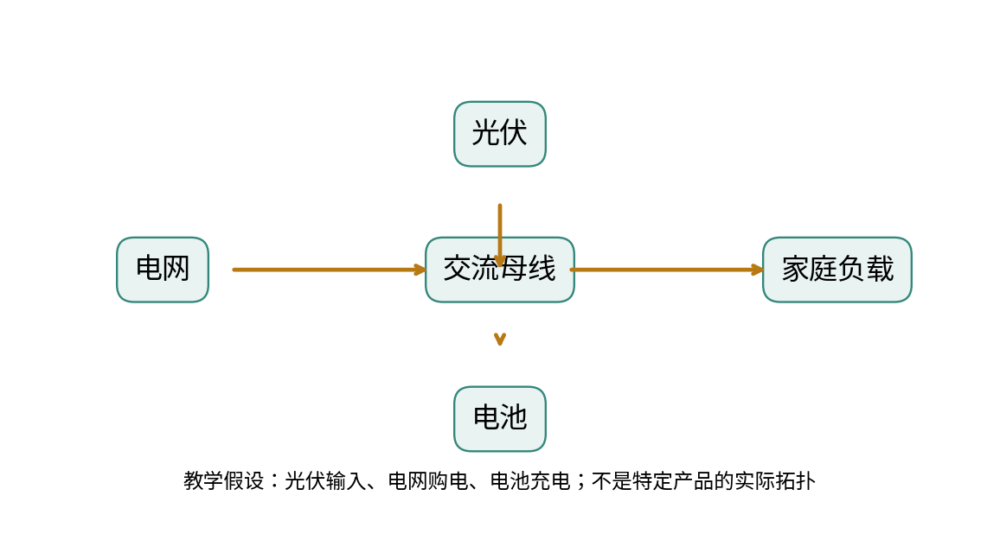

假设家庭交流母线为参考边界，光伏已经换算为交流侧输入，电网输入为正，电池当前充电：


这里假定近似稳态，辅助功耗等纳入损耗，不单独展开短时储能变化。若电池改为放电，需要更新功率方向与表达式。

**不得直接相加**：不同电气侧、不同时间、不同参考方向或不同功率类型的数值。

---

## 四、工作场景示例

> 本节均为教学示例，不代表 HaierEnergy、青络或某型号设备的实际实现。

### 场景 1：光伏 5 kW、负载 3 kW，多余电能去哪了？

假设光伏交流侧输出 5 kW，家庭负载 3 kW，电池不充放电、忽略其他损耗，且电网允许接收多余电能：


多余的 2 kW 可以馈入电网。若禁止馈网，系统需要限发或通过允许的储能、可控负载等方式消纳。能量守恒决定功率必须有去向；具体控制方式由设备能力决定。

### 场景 2：电流 10 A 能直接推出功率吗？

不能。不同系统：

| 系统 | 条件 | 功率 |
|---|---|---:|
| DC | 48 V、10 A | 480 W |
| 单相正弦 AC | 230 V、10 A、PF=1 | 2300 W |
| 单相正弦 AC | 230 V、10 A、PF=0.8 | 1840 W |
| 平衡三相正弦 AC | 400 V 线电压、10 A、PF=0.9 | 约 6235 W |

必须先知道电压、交直流、相数、波形和功率因数等条件。

### 场景 3：逆变器上报有功功率为 0 W，是否已关闭？

未必。可能是待机、并网但零有功、只进行无功交换、辅助电源仍在消耗电能，或小数被取整。`activePower=0` 不等于设备离线、故障或完全无电流。

### 场景 4：电表返回 −1500 W

假设电表约定“电网向家庭为正”，则表示约 1.5 kW 向电网馈电；若接口采用反向定义，结论也反向。

推荐理解路径：**确认计量位置与安装方向 → 确认寄存器符号定义 → 结合其他量判断流向 → 转换为购电/上网含义**。

### 场景 5：电池输出 1 kW，能运行多久？

仅凭功率不够，还需了解当前可用电能、能量转换损耗、截止 SOC、温度及功率变化。

假设负载侧可用电能 4 kWh，恒定负载为 1 kW：

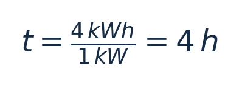

这只是简化估算，并非真实储能系统续航承诺。

### 场景 6：电表、逆变器与负载功率对不上

逆变器输出 4.0 kW、家庭负载 2.5 kW、电表馈网 1.4 kW，差额 0.1 kW。首先考虑测量点不同、未计入支路、损耗、时间戳差异、计量误差和舍入，而不能仅凭差额判定故障。

### 场景 7：设置 5 kW，实际达不到

某直流端口 100 V、电流上限 40 A，仅由电流限制得到：


用户目标为 5 kW，并不改变端口 4 kW 的理论电流限制。分析时区分：**目标值 → 当前运行能力 → 实际测量值**。

---

## 五、易混淆点与知识关联

### 5.1 高频易混淆概念

| 概念对 | 正确理解 |
|---|---|
| 电压 / 电流 | 电压是电势差，电流是电荷流动速率 |
| 电流 / 功率 | 电流存在不意味着有功功率必然相同 |
| 功率 / 电能 | 功率是速率，电能是累计量 |
| kW / kWh | 分别是功率、电能 |
| W / VA | 分别是有功功率、视在功率 |
| 功率因数 / 效率 | 分别是 P/S、有用输出/输入 |
| 交流有效值 / 峰值 | 仅理想正弦波有 `U_m=√2U_{rms}` |
| 相电压 / 线电压 | 测量端点不同 |
| 三相净功率为零 / 三相均零 | 净功率可因正负抵消而为零 |
| 正功率 / 放电 | 必须先确认符号约定 |
| 零功率 / 设备关闭 | 零有功不必然表示关闭 |
| 额定值 / 最大值 | 定义和条件不同 |
| 设置值 / 实测值 | 目标和实际响应不同 |
| 保护阈值 / 用户控制目标 | 分别关系到安全保护与功能控制 |
| 显示精度 / 测量准确度 | 小数位数不等于准确度 |
| 采样频率 / 上报频率 | 测量和通信过程不同 |
| N / PE | 中性线和保护接地导体不能互换 |
| 漏电保护 / 短路保护 | 检测机理和覆盖范围不同 |
| 并网 / 必然上网 | 并网连接不意味着持续馈电 |

### 5.2 与其他模块的关系（仅简述）

- **光伏系统**：进一步学习组件 I-V/P-V 特性、串并联、最大功率点。
- **逆变器**：进一步学习 DC/AC、并网同步、功率控制、滤波和 P-Q 能力曲线。
- **储能与 BMS**：进一步学习电芯充放电、SOC、SOH、BMS 保护与功率限制。
- **电表、并网与离网**：进一步学习双向计量、零馈网、备电、反孤岛及切换机制。
- **电气拓扑与 HEMS**：进一步学习不同设备连接、测量边界与完整能流平衡。

电工基础解释**物理规律**；设备模块解释**硬件实现**；HEMS 解释**如何在物理条件许可的范围内监测、展示和控制**。

---

## 六、重点索引与参考资料

### 6.1 公式速查表

| 知识点 | 公式 | 适用条件 |
|---|---|---|
| 平均电流 | `I=\Delta Q/\Delta t` | 指定时间区间 |
| 欧姆定律 | `U=IR` | 欧姆型电阻 |
| 瞬时功率 | `p(t)=u(t)i(t)` | 电气端口与参考方向匹配 |
| 稳定直流功率 | `P=UI` | 稳定直流 |
| 电阻功率 | `P=I^2R` | 电阻性耗能 |
| 电能 | `E=\int P(t)dt` | 规定时间窗口 |
| 恒定功率电能 | `E=Pt` | 功率不随时间变化 |
| 电阻损耗 | `P_{loss}=I^2R` | 电阻不变时可比较平方关系 |
| 效率 | `\eta=P_{out}/P_{in}` | 输入输出边界对应 |
| 正弦电压有效值 | `U_{rms}=U_m/√2` | 正弦波 |
| 周期 | `T=1/f` | 周期信号 |
| 单相有功 | `P=UI\cosφ` | 正弦稳态 |
| 单相无功 | `Q=UI\sinφ` | 正弦稳态 |
| 视在功率 | `S=UI` | 有效值 |
| 功率因数 | `PF=P/S` | 功率口径一致 |
| 功率三角形 | `S^2=P^2+Q^2` | 经典正弦稳态模型 |
| 星形线电压 | `U_L=√3U_{ph}` | 平衡对称星形 |
| 三相有功 | `P=√3U_LI_L\cosφ` | 平衡三相正弦稳态 |
| 感抗 | `X_L=2\pi fL` | 理想线性电感 |
| 容抗大小 | `|X_C|=1/(2\pi fC)` | 理想电容 |
| 电容储能 | `E_C=\frac12CU^2` | 理想线性电容 |
| 电感储能 | `E_L=\frac12LI^2` | 理想线性电感 |
| 理想变压器 | `U_2/U_1=N_2/N_1` | 理想变压器模型 |

### 6.2 按问题查找知识

| 实际关心的问题 | 对应章节 |
|---|---|
| 看懂接口功率字段 | 3.2、3.4、3.9、3.11 |
| 判断能流平衡 | 3.1、3.2、3.11 |
| 理解电池充放电 | 3.2、3.7、3.11 |
| 理解逆变器功率限制 | 3.4、3.7、3.8 |
| 分析三相差异 | 3.4、3.5、3.9 |
| 分析电表计量 | 3.5、3.9、3.11 |
| 区分控制与保护 | 3.8、3.10 |
| 分析零值、负值 | 3.2、3.9、3.11 |
| 判断电力数据偏差 | 3.8、3.9、3.10 |

### 6.3 参考资料

以下链接用于查阅通用原理、官方标准范围，不等于特定项目已经采用该标准或使用了某个具体条款。

1. **OpenStax · University Physics Volume 2, Chapter 10 — Direct-Current Circuits**：电路、欧姆定律、基尔霍夫定律。  
   https://openstax.org/books/university-physics-volume-2/pages/10-introduction
2. **OpenStax · University Physics Volume 2, Chapter 15 — Alternating-Current Circuits**：交流电、RLC、电力、功率因数、变压器。  
   https://openstax.org/books/university-physics-volume-2/pages/15-introduction
3. **IEEE 1459-2025 — Definitions for the Measurement of Electric Power Quantities**：正弦、非正弦、平衡与不平衡情形下的功率测量术语。  
   https://standards.ieee.org/ieee/1459/7578/
4. **IEC 61000-4-30:2025 — Power quality measurement methods**：50/60 Hz 系统电能质量测量方法。  
   https://webstore.iec.ch/en/publication/71611
5. **IEC 61140:2016 — Protection against electric shock**：电击防护基础原则。  
   https://webstore.iec.ch/en/publication/23997

> **标准适用声明**：具体产品、设备型号、销售区域以及当地并网与安装条件，应核实适用的现行法规、标准版本、修订及强制要求；不应把上述通用参考直接转化为某一国家或某一设备的参数限值。

---

## 七、本模块总结

1. **物理规律是底座**：设备和软件都必须遵守电压、电流、功率和能量守恒的基本关系。
2. **功率与电能不同**：kW 描述速率，kWh 描述累计，不能凭某时刻功率推断全天电量。
3. **交流电需要考虑相位与波形**：有功、无功、视在功率及功率因数各有定义与适用边界。
4. **三相系统可能不平衡**：总功率可以掩盖各相不同的电能交换情况。
5. **功率正负需要参考方向**：字段数值不脱离测量位置、单位、符号和时间戳理解。
6. **设备受到多重约束**：额定值、最大值、保护阈值、目标设定值与实测值是不同概念。
7. **电力数据不是物理世界本身**：测量方式、采样窗口、准确度、倍率、时间同步与数据传输都会影响展示结果。

```text
物理规律
  ↓
电气设备及其运行限制
  ↓
传感器与电表测量
  ↓
寄存器、接口和数据传输
  ↓
HEMS 能流展示、状态判断与控制
```

**最终目标**：不仅能读懂数据，还能从电工原理解释设备为何这样运行、哪些现象可能正常、哪些结论需要进一步核实。

---

*电工基础模块 · 完*
