# 光伏系统

> **知识领域**：新能源电力与设备原理　｜　**学习模块**：光伏系统  
> **学习深度**：深入理解　｜　**岗位视角**：新能源 HEMS 产品经理  
> **资料说明**：2026-10-10 整理。除明确注明的标准与官方资料外，数值与场景均为**教学示例**，不代表 HaierEnergy、青络 IoT 或任何具体设备的真实实现、规格或数据。

本文按照“**物理原理 → 设备行为 → 成立条件与限制 → 对 HEMS 的影响**”组织。它面向产品经理建立判断能力，不代替电气设计、设备安装与合规认证。

## 一、模块定位与知识结构

### 1.1 什么是光伏系统

光伏系统（Photovoltaic System，PV System）利用**光伏效应**，把太阳辐射能直接转化为电能。完整的户用光伏系统不只是屋顶组件，通常还涉及组件与组串、直流线路、汇流与保护、功率转换、交流并网、计量、通信及监测。

光伏系统有三个特征：

1. **太阳资源具有波动性**。辐照度、光谱、温度、朝向、遮挡与污染会影响可用发电能力。
2. **设备存在运行边界**。即便组件能够发电，MPPT、逆变器输入范围、交流输出上限、电网条件与保护状态都可能限制实际输出。
3. **发电不等于本地消费**。电能可能被家庭使用、为电池充电、馈入电网；当系统不允许或不能吸收多余功率时，也可能被主动限发。

因而，“6 kWp 为什么只有 3 kW”“PV 有电压为什么功率为 0”“零馈网为什么还在发电”等问题，都要从物理能力、转换能力、管理策略三层综合判断。

### 1.2 光伏在 HEMS 中的位置

HEMS（Home Energy Management System，家庭能源管理系统）协调家庭的本地发电、消费、储能和电网交换。光伏通常是本地发电源；逆变器与储能系统负责电能转换，HEMS 则基于设备支持的控制能力进行监测和协调。

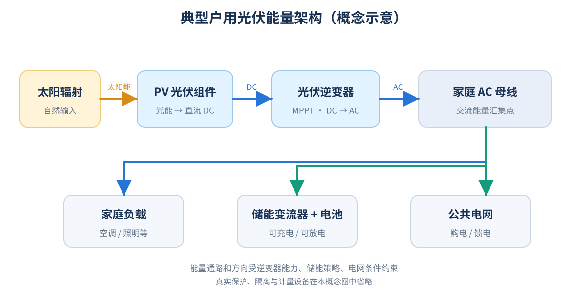

*图 1-1　典型 AC 母线示意。太阳能由 PV 转为直流，逆变器将其转换为交流；负载、储能及电网之间的具体能量方向取决于拓扑、运行状态和策略。图示不是设备接线图。*

| 技术层 | 核心职责 | 常见内容 |
|---|---|---|
| 物理发电层 | 将太阳辐射转换为直流电 | 电池片、组件、组串、阵列 |
| 电力转换层 | 提取、转换和约束电功率 | MPPT、DC/DC、DC/AC、保护 |
| 能源管理层 | 监测状态并按允许能力实施策略 | HEMS、自发自用、储能调度、零馈网 |

HEMS **不能决定阳光强度**，也不能突破设备硬件上限；它只能在设备提供控制能力、通讯可用且安全条件允许时，影响实际取电、充放电及馈网行为。

### 1.3 知识链条与模块边界

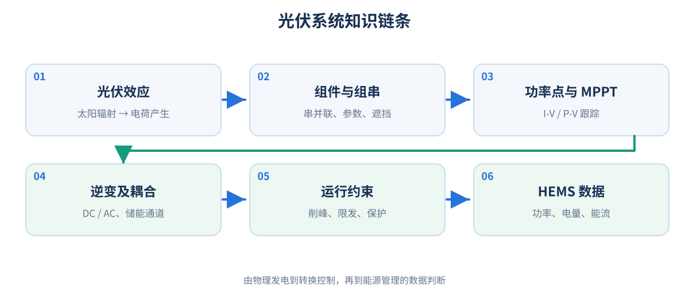

*图 1-2　从光伏效应、组件组串、MPPT、逆变转换，到运行策略、功率平衡和 HEMS 数据解释的知识链。*

本模块重点深入：发电机理、I-V/P-V 曲线、组串电气关系、MPPT、辐照和温度、逆变器与耦合方式、削峰/限发/保护、发电量与能流数据。

与其他模块的关系只保留必要接口：

| 其他学习模块 | 本模块需要的关联 | 暂不深入 |
|---|---|---|
| 电工基础 | 电压、电流、功率、电量、交流与直流 | 复杂电路推导 |
| 逆变器 | DC/AC 转换、额定输出、保护与 MPPT | PWM、电力电子器件设计 |
| 储能与 BMS | 充电许可、SOC、充电功率上限 | 电芯化学与 BMS 算法 |
| 电表与并离网 | 计量点、购馈电、零馈网、防孤岛 | 并网保护整定和国家级规范条文 |
| 电气拓扑 | AC/DC 耦合、母线、能量路径 | 施工级接线设计 |
| IoT 与物模型 | 字段语义、数据有效性和刷新 | 寄存器映射与通信帧细节 |

### 1.4 应达到的技术理解深度

产品经理需要能够独立解释“为什么出现这种设备行为”，并在评审中提出**必须确认哪些测量点、约束、状态与数据来源**；不要求计算半导体能带结构、设计 MPPT 电路或确定光伏支架施工参数。

---

## 二、必要基础

### 2.1 直流电、交流电与光伏输出

光伏电池片及组串首先输出**直流电（DC）**：端口极性通常固定，但电压与电流大小会随光照和工作点变化；直流不等于恒定不变。家庭公共供电系统通常采用**交流电（AC）**，电压和电流周期性变化。

| 对比 | 直流 DC | 交流 AC |
|---|---|---|
| 典型来源 | PV、蓄电池、直流母线 | 逆变器、电网 |
| 主要用途 | 光伏汇集、部分储能充放电链路 | 普通家庭负载、并网交换 |
| 相关转换 | DC/DC 调压或电流控制 | DC/AC 逆变、AC/DC 整流 |

组件“产生电”不等于家庭交流负载能够直接使用：还需要合适的电压、功率转换、安全保护和目标系统运行条件。

### 2.2 电压、电流与直流功率

- **电压**（Voltage，U 或 V），单位 **V（伏特）**：两点间的电势差。
- **电流**（Current，I），单位 **A（安培）**：单位时间流过截面的电荷量。
- **功率**（Power，P），单位 **W（瓦特）**、**kW（千瓦）**：能量转化或传递的速率。

对同一稳态直流工作点，**P = U × I**。

例如 PV 端电压 400 V、电流 10 A，则当前直流功率 = 400 × 10 = **4,000 W = 4 kW**。这是某一时刻的功率，不是一小时的发电量。对于交流有功功率，还需考虑相数和功率因数，不能无条件套用直流公式。

### 2.3 功率与电量

- **功率 kW**：现在发电有多快。
- **电量 kWh**：一段时间里产生或消耗多少电能。

恒定功率下：**E = P × t**。E 单位 kWh，P 单位 kW，t 单位 h（小时）。例如持续 2 kW 发电 3 小时，则 E = 6 kWh。

| 时间区间 | 区间平均功率 | 区间发电量 |
|---|---:|---:|
| 09:00—10:00 | 2 kW | 2 kWh |
| 10:00—11:00 | 3 kW | 3 kWh |
| 11:00—12:00 | 4 kW | 4 kWh |
| 合计 | — | **9 kWh** |

功率随时间变化时，真实电量是功率的时间积分；采样统计可按 **E ≈ Σ(Pᵢ × Δt)** 估算（Pᵢ 为区间平均功率，Δt 以小时计）。若 Pᵢ 只是间歇采到的**瞬时值**，这样计算只是近似，质量受到采样间隔和波动影响。正式电量统计应优先采用有效的累计电量计数器。

### 2.4 STC、额定功率与实际功率

组件铭牌中的额定最大功率一般基于**标准测试条件（STC）**：

| STC 项目 | 数值或定义 |
|---|---|
| 辐照度 | 1,000 W/m² |
| 电池片温度 | 25°C |
| 光谱条件 | AM1.5 标准光谱 |

额定峰值功率常使用 **Wp/kWp** 表示，如 10 块 550 Wp 组件的标称直流装机容量是 **5.5 kWp**。它不表示系统任何时刻都能输出 5.5 kW。与 STC 不同的温度、辐照、入射角及设备条件都会改变实时输出；在极为有利的条件下，瞬时直流输出亦可能超过 STC 铭牌值。

需要区分：**组件 DC 装机容量（kWp）**、**逆变器 AC 额定功率（kW）**、**实际 PV 输入 DC 功率（kW）** 和 **电网连接点交换功率（kW）**。

### 2.5 辐照度、辐照量与太阳资源

**辐照度**（Irradiance，W/m²）是单位面积在某时刻接收到的太阳辐射功率；**辐照量**（Irradiation，kWh/m²）是一定时间累计的太阳辐射能量。

例如组件平面辐照度若稳定为 800 W/m²、持续 2 h，对应平面辐照量为 **1.6 kWh/m²**。

| 指标 | 英文 | 意义 |
|---|---|---|
| GHI | Global Horizontal Irradiance | 水平面总辐照度 |
| DNI | Direct Normal Irradiance | 垂直于太阳直射方向的直接辐照度 |
| DHI | Diffuse Horizontal Irradiance | 水平面散射辐照度 |
| POA | Plane of Array Irradiance | **组件安装平面**接收到的辐照度 |

POA 比仅以 GHI 更接近组件实际接收到的太阳能，但仍需考虑光谱、角度效应等因素。这些指标的受光平面不同，不能直接互换。

### 2.6 转换效率、系统损耗与 PR

效率总是对**指定能量边界**而言：

- **组件转换效率 η = 组件输出电功率 / 组件表面入射太阳功率**。例如面积 2.5 m²、辐照 1,000 W/m²，若输出 550 W，η = 550 / 2,500 = **22%**。
- **逆变转换效率 η = AC 有功输出 / DC 有功输入**。例如输入 5 kW、输出 4.8 kW，则 η = **96%**。混合逆变器具有多能量通道时，应明确是否有电池等其他输入输出，不能套用单输入示例。
- **性能比 PR（Performance Ratio）**用于描述系统发电表现与参考太阳资源所对应发电潜力之比，**不等于组件效率**。

光学反射、温升、线损、遮挡、失配、转换损耗、停机、限发与污染等，都可能降低最终的可计量发电量。不应重复扣除同一损失。

---

## 三、核心知识详解

### 3.1 光伏效应：太阳光如何变成电

常见晶硅电池通过半导体吸收光子，把能量传递给电子并形成可移动的电子—空穴载流子。电池中的结结构和电极有助于分离、收集载流子，从而向外部电路提供电能。

可按如下链条理解：**阳光入射 → 光子被吸收 → 载流子产生 → 内部结构促进分离 → 电极收集 → 外电路获得电能**。

太阳能电池不是“先存阳光，再在晚上放电”的装置，也不通过传统燃烧与热机发电。不是所有太阳光都会变成电：有的反射、透过，有的能量形成热或在电池内部损失。[美国能源部：光伏电池基础](https://www.energy.gov/cmei/systems/solar-photovoltaic-cell-basics)。

#### 3.1.1 有阳光为什么也可能不发电

出现可用功率需要同时考虑：① 组件接收到足够的有效光照；② 形成允许取电的电气工作点；③ 后级逆变设备及目标电网/负载通道具备运行条件。逆变器保护停机时，PV 端可能仍有直流电压，但**没有有效电流，也就没有对应的输出功率**。

### 3.2 电池片、组件、组串与阵列

| 层级 | 英文 | 含义 |
|---|---|---|
| 电池片 | Cell | 基本光伏转换单元 |
| 组件 | Module | 多片电池片封装的发电单元 |
| 组串 | String | 多块组件串联形成的电气回路 |
| 阵列 | Array | 一个或多个组串组成的光伏集合 |
| 系统 | PV System | 发电、转换、保护和监测组成的整体 |

组件可能包含玻璃、封装材料、电池片、背板或背面玻璃、边框、接线盒、旁路二极管与连接器。具体结构因组件类型而异。

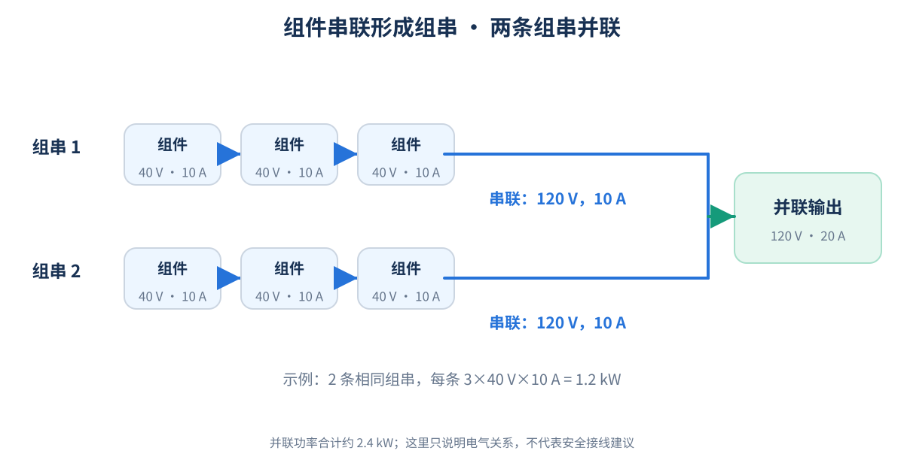

*图 3-1　组串通过串联提升电压、并联提高可用总电流。图中相同组件的数值是教学示例，不是实际安装规范。*

#### 3.2.1 串联：电压相加、电流受约束

串联时 **U总 = U1 + U2 + … + Un**，相同回路的电流相等。10 块在同一工作点均为 40 V、10 A 的组件串联，理论上可得到 **400 V、10 A、4 kW**。若其中某一组件因遮挡降低了电流能力，整串可能受到限制；实际情况还与旁路二极管及工作点有关。

#### 3.2.2 并联：电压相同、电流相加

并联组串需匹配适当的电压条件；两条均为 400 V、10 A 的组串并联，理论上可得到 **400 V、20 A、8 kW**。实际设计需检查逆变器输入电流、短路电流上限及保护要求，不能无限增加并联支路。

#### 3.2.3 PV1、PV2 与 MPPT1、MPPT2 不必然对应

PV1/PV2 可能是不同物理输入端口，也可能是不同 DC 测量通道；多个组串可能共用同一 MPPT，两个端口不保证存在两个独立的跟踪控制器。**具体映射必须以设备手册与物模型为准**，不能从字段名称猜测设备安装拓扑。

### 3.3 光伏组件的电气参数

| 参数 | 英文缩写 | 物理含义及应用 |
|---|---|---|
| 最大功率 | Pmax | 指定条件下可达到的最大输出功率 |
| 开路电压 | Voc | I = 0 时的端电压；用于组串过压安全校核 |
| 短路电流 | Isc | 端电压约为 0 时的电流；用于输入和保护设计校核 |
| 最大功率点电压 | Vmp | 组件输出功率最大的工作点电压 |
| 最大功率点电流 | Imp | 相应工作点的电流 |
| 温度系数 | γ 等 | 温度改变对组件电压和功率的影响 |

**Pmax = Vmp × Imp**（单位 W = V × A）。示例：Vmp = 42 V，Imp = 13.1 A，则 Pmax ≈ **550.2 W**，与 550 W 的标称值接近，差异来自取整。

开路时 I = 0，尽管 Voc 可能很高，但 P = 0。短路时 U ≈ 0，组件向短路端口传递的功率接近 0，但短路电流仍可能带来电气风险。**Voc 不等于 Vmp，Isc 不等于 Imp**；通常 Voc > Vmp、Isc > Imp。

### 3.4 I-V 曲线、P-V 曲线与最大功率点

组件的电压与电流不是两个可以独立任意指定的值。**I-V 曲线**描述给定辐照和温度下端电压与输出电流的关系；对应 **P-V 曲线**由 P = U × I 得出。

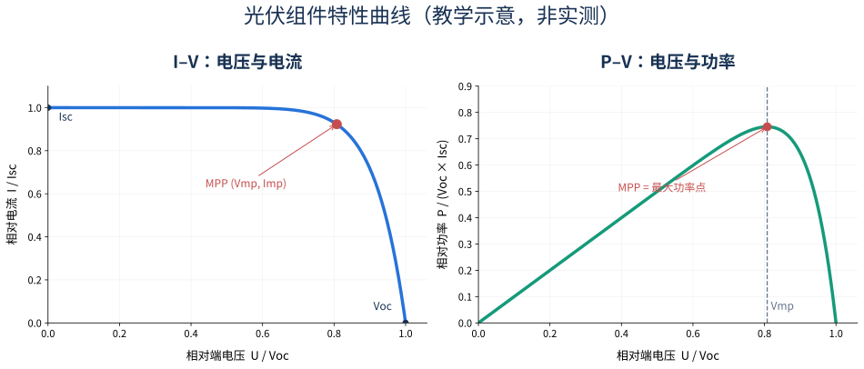

*图 3-2　示意 I-V 与 P-V 曲线，标出 Voc、Isc、Vmp、Imp、MPP。曲线形状仅示意，刻度是归一化的相对值；真实曲线随组件和环境变化。*

短路附近电流高但电压低，输出功率很小；开路附近电压高但电流趋近 0，功率也很小。**最大功率点（MPP）**出现在两者之间，是电压与电流乘积最大的工作点。

辐照度下降时，光生电流通常明显减少，最大功率降低；电压也会变化，但不一定同等比例。温度升高时，晶硅电池电压通常下降，因而最大功率通常降低。

在局部遮挡时，旁路二极管可能改变组串曲线形状，P-V 曲线可能出现**多个局部峰值**。因此不是所有局部寻找峰值的控制算法都能自动找到全局最大功率点。

### 3.5 MPPT：如何从组件获取更多可用功率

**最大功率点跟踪（Maximum Power Point Tracking，MPPT）**是调节 PV 端工作点、在设备限制内尽量获得当前最大可用功率的控制过程。它不创造额外太阳能，而是减少因工作点选取不合适造成的可避免损失。

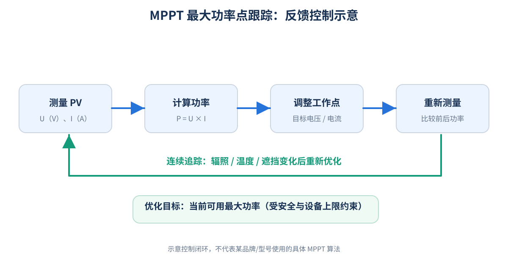

*图 3-3　MPPT 的概念闭环：测量电压/电流 → 计算功率 → 调整工作点 → 比较结果并继续跟踪。它不是某一型号的实际控制程序。*

#### 3.5.1 为什么不能固定一个光伏工作电压

组件最佳工作电压受光照、温度、遮挡与老化影响。如果逆变器固定在某个电压，环境变化后可能偏离最大功率点。因此 DC/DC 或其他功率变换环节通常通过控制输入侧工作点实现跟踪。

#### 3.5.2 MPPT 怎样跟踪

典型概念流程：测 U、I → 算 P → 小幅改变目标工作点 → 再次算 P → 判断改动是否提升功率 → 继续或反向调整。常见算法包括扰动观察法、增量电导法，复杂设备还可能提供遮挡时的全局峰值搜索。产品经理需要理解算法目标和约束，不必推导控制器方程。

#### 3.5.3 MPPT 和设备输入边界

| 设备参数 | 主要含义 |
|---|---|
| 最大 DC 输入电压 | 不允许超过的输入电压限值，不等于 MPPT 可工作上限 |
| MPPT 电压范围 | 可执行跟踪的输入电压区间 |
| 满载 MPPT 电压范围 | 有些设备规定可达到额定输出的更窄区间 |
| 启动电压 | 从停机进入启动过程相关的阈值，可能与运行保持电压不同 |
| 最大输入电流 | 对某路输入允许提取的电流能力约束 |
| 最大短路电流 | 对可接入组串短路电流的限制 |
| 最大 PV 接入容量 | 厂商规定的组件配置范围，与 AC 额定功率不一定相同 |

例如设备的最大输入 600 V、MPPT 范围 120—550 V、启动电压 150 V，三者不是一个概念：600 V **不能被解读为正常跟踪工作电压**，120 V 也不表示从停机必然立即启动。

#### 3.5.4 多 MPPT 与东西向屋顶

东向组串上午光照强，西向下午更强。如果分别接入独立 MPPT，可按各自受光条件寻找工作点；不同受光和电气特性的组串直接共用一个 MPPT，可能发生失配损失。但是否可共接要结合具体组件参数及设备手册判断，不能“一刀切”。

### 3.6 光照、温度、朝向、遮挡与衰减

#### 3.6.1 光照对发电的近似影响

在**电池片温度和其他条件近似不变**时，可初步用 **P ≈ P_STC × G / 1000** 估算（P 与 P_STC 单位 W，G 单位 W/m²）。如 STC 为 500 W 的组件，组件平面辐照度 800 W/m²，忽略其他差异，估算功率 **400 W**。这不是精确模型，不能用于取代实际发电预测或验收。

#### 3.6.2 为什么大晴天反而会因高温损失功率

晶硅组件温度升高时，电压通常下降，电流仅有较小变化，整体最大功率多表现为下降。可用一阶近似：**P(T) ≈ P_STC × [1 + γ × (Tcell − 25)]**。其中 Tcell 是**电池片温度（°C）**，γ 为功率温度系数（1/°C），必须配合同样的辐照基准。

示例：500 W、γ = −0.0035/°C、Tcell = 45°C，且假设辐照仍为 STC，则 P(45) ≈ 500 × [1 − 0.0035 × 20] = **465 W**，较 STC 降约 **7%**。**空气温度不等于电池片温度**，后者还受风速、安装散热和辐照影响。[美国能源部：光伏性能与效率](https://www.energy.gov/cmei/systems/solar-photovoltaic-performance-and-efficiency-basics)。

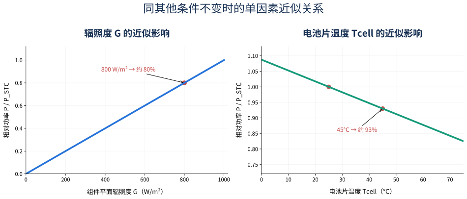

*图 3-4　仅表示单因素变化的教学近似：辐照与功率的粗略比例关系、固定辐照下的负温度系数。不可据此生成精确生产预测。*

#### 3.6.3 朝向与倾角

朝向、倾角影响入射角和组件平面的日辐照量。在北半球中纬度地区，面向赤道一侧的固定组件常有利于增加全年发电，但实际最优方案还取决于屋顶、遮挡、季节、价格和家庭用电时间。东西向可能降低峰值却拓宽发电时间窗口；不能单凭方向判断系统好坏。

#### 3.6.4 遮挡、旁路二极管与热斑

组串串联电流受共同回路制约，部分遮挡不一定只损失被遮挡面积对应的发电功率。组件常配置**旁路二极管**，在一定条件下可让部分受限电池片子串被旁路，从而减轻输出受阻和某些反向偏置风险，但**不能完全消除热斑和遮挡损失**。局部过热可导致长期劣化或损坏。

#### 3.6.5 污染、老化与组件失配

积灰、积雪、树影、连接器问题、线缆损耗、组件电气参数不一致与长期材料劣化都可能降低产出。排查时应先区分天气和安装差异，再考虑限功率与设备异常，不能见到发电下降就立即归咎于组件损坏。

### 3.7 常见光伏电池与组件技术

| 技术 | 概念 | 产品经理关注点 |
|---|---|---|
| 晶硅 | 使用单晶或其他晶体硅结构进行光电转换 | 市场应用广、规格和性能需要看具体型号 |
| 薄膜 | 在基底上形成较薄的光伏材料层，如 CdTe、CIGS | 适用场景、功率密度、环境特性不同 |
| PERC | 通过钝化与背面相关结构优化电池性能 | 比较损耗与效率，不能只凭名称判断优劣 |
| TOPCon | 隧穿氧化层钝化接触技术 | 降低部分复合损耗、改善性能 |
| HJT | 异质结电池技术 | 材料与接触结构、温度性能等 |
| IBC | 背接触架构的一类 | 减少正面金属电极遮挡等影响 |
| 双面组件 | 同时利用正面与背面辐照 | 背面增益取决于地面反照率、安装高度等条件 |

这些名称并不始终是彼此排斥的分类维度；电池技术可能组合。详细性能请以组件规格书、适用测试条件和现场条件为准。

### 3.8 逆变器：DC/AC 转换与运行控制

逆变器不仅把 PV 直流电变成家庭/公共电网需要的交流电，还负责 MPPT、并网同步、有功和无功管理、保护、状态监测以及与 HEMS 的数据交互。逆变器输出交流电并不意味着任何时候都被允许向公共电网馈电。

| 类型 | 典型工作方式 | 注意点 |
|---|---|---|
| 组串式逆变器 | 汇集一条或多条组串完成转换 | 关注 MPPT/组串配置、输入限制 |
| 微型逆变器 | 在一块或少数几块组件附近转换 | 组件级独立性、AC 侧系统与通信架构 |
| 混合逆变器 | 集成光伏、储能等多个能量通道 | 充放电路径与上限、是否支持备电 |

“混合”描述功能集合，和“组串”不是必然互斥的两个维度。

### 3.9 直流耦合与交流耦合

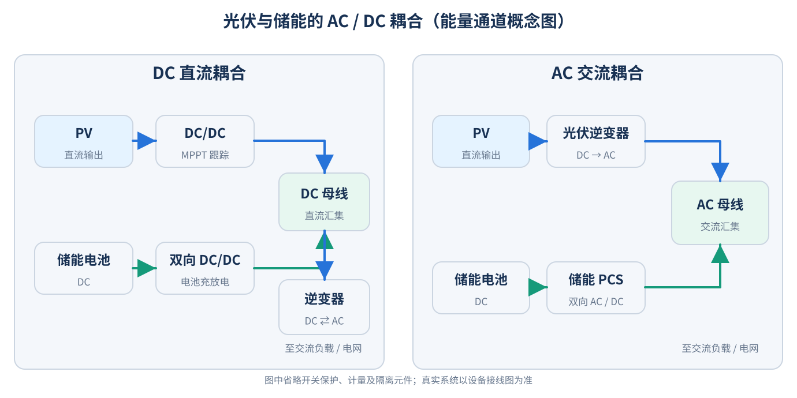

*图 3-5　光储两种常见耦合的抽象能量路径。交流耦合的电池通道通常有双向 AC/DC 转换；直流耦合由 DC/DC 与逆变等环节实现。具体内部拓扑须以设备手册为准。*

- **DC 耦合**：PV 与电池经适当 DC/DC 转换等环节在直流侧交换能量，再通过逆变设备向 AC 侧供能。某些 PV→电池充电路径可减少 AC/DC 往返转换。
- **AC 耦合**：光伏逆变器和储能变流器分别接到交流侧；升级现有光伏系统时可能更灵活，但转换路径与损耗不同。

不能直接认定某种耦合“永远效率更高”或“天然能备电”。应看设备路径、输出限制、电网失电隔离方案及策略。

### 3.10 DC/AC 容量比、削峰与降额

DC 容量是组件 STC 功率总和；AC 容量通常是逆变器额定交流输出。**DC/AC 容量比 = DC 标称容量 / AC 标称容量**。例如 6 kWp 组件配 5 kW AC 逆变器，DC/AC = **1.2**。

配置较高 DC 容量，可能提升低辐照条件下的逆变器利用程度，但强光条件下，当系统达到交流输出上限，可能发生 **Clipping（削峰）**。某些混合系统还能给电池充电，其 PV 实际可获取功率不能简单等同于 AC 额定功率。

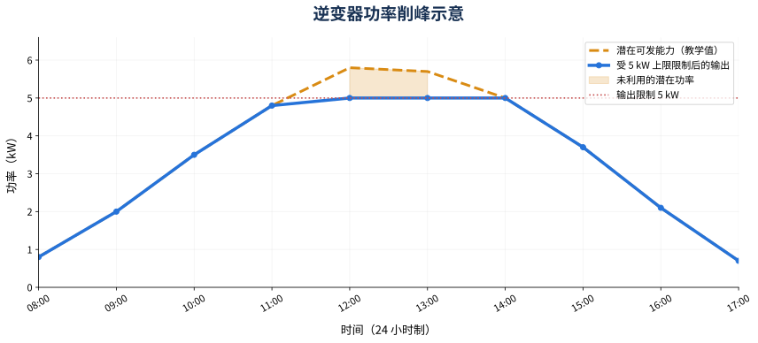

*图 3-6　假设逆变器 AC 最大输出 5 kW，忽略转换损耗，潜在可发功率在午间高于 5 kW 时，输出出现上限平台。现实中的 DC、AC 功率和损耗边界需分别计量。*

**降额（Derating）**与削峰不同：降额是允许输出上限因温度等条件发生下降；削峰是可用输入超过既定转换能力导致部分潜在功率未被利用。两者都不一定是故障。

### 3.11 启动、待机、运行、限发与保护停机

| 概念状态 | 常见触发 | 功率可能表现 |
|---|---|---|
| 待机 | 输入不足、等待并网/运行条件 | 0 或接近 0 |
| 启动准备 | 自检、输入与电网条件核查 | 尚无稳定输出 |
| 正常运行 | 满足输入与安全条件 | 按可用功率与策略输出 |
| 限功率 | 馈网限制、外部调度、设备约束 | 低于潜在可发功率 |
| 温度降额 | 设备温度相关限制 | 允许输出上限下降 |
| 保护停机 | 电气安全条件不满足 | 停止相应能量输出 |
| 故障 | 设备检测到异常 | 按保护逻辑停机或限制 |
| 通讯异常 | 设备数据链路不可用 | **不能据此判断实际物理发电状态** |

光伏组件有电压不代表逆变器已允许取电。启动电压、维持运行电压、MPPT 范围可能不同。早晨组件电压达某个值但没有立即发电，可能是正常启动条件尚未满足。

对于典型并网逆变器，电网电压、频率与同步条件是重要运行条件。防孤岛功能防止系统在不允许的情况下向已与公共电网断开的线路继续供电。有备电能力的混合逆变器，在满足相应隔离措施时可以向**独立备电侧**供电，并不代表可以继续向失电公共电网馈电。

### 3.12 电气保护与安全边界

| 保护机制 | 用途 |
|---|---|
| 输入过压、过流 | 避免设备超过输入能力 |
| 绝缘与接地故障检测 | 识别部分绝缘/接地风险 |
| 电弧故障检测（如支持） | 识别危险电弧风险 |
| 温度保护 | 避免关键部件过热 |
| 电网过欠压、过欠频 | 处理电网运行异常 |
| 防孤岛保护 | 防止不允许的孤岛供电 |

设备是否提供、如何配置或采用哪些保护功能，取决于设备类别及目标市场要求。**逆变器关闭并不等于白天光伏直流线路已经无电压**。此处为原理说明，不提供带电操作或施工指导，现场作业应由专业人员按当地规定执行。

### 3.13 发电量估算、峰值日照小时与 PR

简单估算可用：**E日 ≈ P_STC × H × PR**，其中：

- E日：日交流发电量，单位 kWh。
- P_STC：直流装机功率，单位 kWp。
- H：组件安装平面的日峰值日照小时（h），等于该平面日辐照量（kWh/m²）除以 1 kW/m²。
- PR：假设的综合性能比（无量纲，采用 0—1 的小数形式）。

示例：6 kWp、H = 4 h、PR = 0.8，则 E日 ≈ **19.2 kWh**。这是教学估算，不能把 PR 当成设备的固定“效率”；还需避免温度、逆变、限发等损失重复计入。

**等效利用小时 = 某周期发电量（kWh） / 额定容量（kW）**。若 6 kWp 电站一年输出 7,200 kWh，则等效利用小时约 **1,200 h**。比较时需统一交流/直流计量边界与容量分母。PVWatts V8 对发电量提供更完整的模型，包含设备、天气和损耗参数；见 [官方 API 文档](https://developer.nlr.gov/docs/solar/pvwatts/v8/)。

### 3.14 光伏实时功率、计量口径与能流关系

物模型中的 `pvPower` 不一定指唯一物理量，可能是单路 DC、DC 总输入、AC 光伏输出或其他估算口径。必须确认**测量点、方向、单位、时间戳、是否含损耗、是否重复计量**。

在各输入属于相同 DC 计量边界、方向一致、时间同步且无重复计数时：**P_PV,total = ΣP_PVi**。若 PV1、PV2 是不同时间的数据、存在重复统计或口径不同，不能直接相加。

对于一个理想化 AC 母线，约定光伏 AC 输出为正、电池 AC 放电为正（充电为负）、电网购电为正（馈网为负）、负载消耗为正：

**P_PV,AC + P_Battery,AC + P_Grid = P_Load**。

例如光伏交流输出 4 kW，电池 AC 侧充电 1 kW（−1 kW），负载 2 kW，则 P_Grid = −1 kW，即向电网馈出约 1 kW。此式是**同一交流边界、忽略线损和其他通道的模型**；对 DC 耦合混合系统，绝不能把 PV DC 功率、AC 负载和电池端功率直接视为无损平衡。

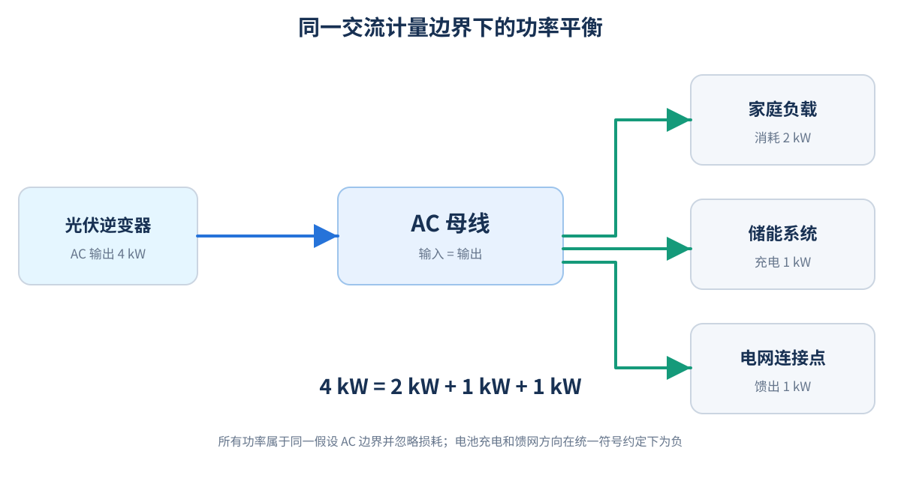

*图 3-7　4 kW 光伏 AC 输出中，2 kW 供负载、1 kW 给电池充电、1 kW 向电网馈出；所有数字均在相同的理想 AC 口径下表示。*

### 3.15 自发自用、馈网与储能归因

光伏发电量不等于光伏自用量。没有储能、没有其他本地电源且统一 AC 侧计量时，忽略损耗可近似写为：**光伏发电量 = 光伏本地消纳量 + 光伏馈网量**。

引入电池后，电池电能可能来自光伏，也可能来自电网；放电存在损耗，且很多系统没有按来源追踪电池内部能量。“光伏供电给负载”在共用交流母线场景中往往是依据净功率和**约定分配规则**进行逻辑归因，而不是对单个电子来源的直接测量。

### 3.16 数据有效性与设备状态不能混为一谈

| 数据表现 | 正确理解 |
|---|---|
| `pvPower = 0` | 若数据有效，表示当前该口径测得的功率为零；不自动意味着故障 |
| `pvPower = null` | 缺失或无有效数据，其语义要看接口约定；不能直接当作 0 |
| 字段缺失 | 可能是设备不支持、模型不同或接口问题 |
| 设备离线 | 当前设备通讯不可用；**不能仅凭此判断实际物理发电状态** |
| 历史值仍有数字 | 必须检查采样时间和是否过期 |
| `batterySOC = 55` | 仅说明某有效数据点代表约 55% 的荷电状态；不证明电池现在一定可充放电 |

常见数据还有 PV 电压、电流、日/总发电量、MPPT 状态、温度、告警、限功率原因与设备运行状态。不同产品的统计日界线、数据刷新周期、重置条件或单位可能不同，应以设备/接口定义为准。


---

## 四、工作场景示例

> 本章所有数据都是**为了演示机制而自设的条件**，不是实际设备规格或实测记录。实际判断必须先检查数据来源、测量口径、策略和设备手册。

### 4.1 6 kWp 为什么只产生 3 kW

一户家庭装机 **6 kWp**，某时刻 PV 直流功率只有 **3 kW**，不应直接判断故障。假设组件平面辐照度 600 W/m²，电池片 45°C，功率温度系数 −0.35%/°C，使用两个一阶近似：

**P ≈ 6 × (600/1000) × [1 − 0.0035 × (45 − 25)] ≈ 3.35 kW**。

若进一步存在积灰、遮挡、失配或控制约束，观察到约 3 kW 在物理上可以解释。但这个计算**不能证明具体电站正常**，仍需核实：

1. 6 kWp 是否是组件额定 DC 容量，3 kW 是否同为 DC 输入功率；
2. 具体时刻的组件面辐照、温度、遮挡和安装朝向；
3. 逆变器是否限发、削峰、降额或出现其他状态变化；
4. 与同天气、同季节和同时间窗口的历史表现相比是否显著异常。

**对产品判断的影响**：不要把“低于装机容量的某固定比例”直接判为光伏故障，尤其不能忽略辐照度与功率统计边界。

### 4.2 晴天中午的功率平台和削峰

假设 6 kWp 组件连接标称最大持续输出 5 kW 的逆变器，PV 阵列中午潜在发电能力约 5.8 kW，没有其他 DC 用能通道或电池充电路径。逆变器到达 AC 输出限制后，可能不再从组件获取全部潜在功率，AC 输出在 5 kW 附近形成平台（见图 3-6）。

这只是削峰的一种情况。也可能出现电网调度限发、温度降额、零馈网约束等其他平台原因。应区分**潜在可发功率**、**实际 DC 取电功率**与**AC 输出功率**，不能只凭平顶曲线判断具体原因。

### 4.3 PV 有 380 V 电压但功率是 0

假设 PV 输入监测：U = 380 V、I = 0 A、P = 0 W，设备显示待机。按 P = U × I，0 W 与此数据一致。可能原因包括未满足并网启动条件、尚未允许取电、限发/停机命令或者保护状态等。

组件**有开路电压，并不意味着正在向外输送功率**；单独的电压值也不能证明“太阳能一定足够”或“线路一定正常”。

### 4.4 东西屋顶的 PV1、PV2 为什么时序不同

假设东向 PV1 与西向 PV2 均为 3 kWp，并使用独立 MPPT。上午 PV1 输出通常较高，下午 PV2 往往更高。即使组件型号一致，两组功率曲线也未必对称，因为太阳位置、云层与遮挡不同。

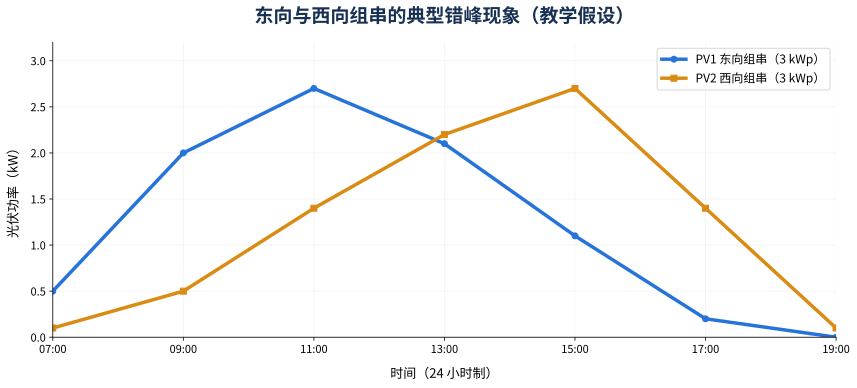

*图 4-1　两个各为 3 kWp 的假设阵列，在同一天的不同时间段出现不同功率峰值。它不是当地发电预测。*

评估“两路 PV 功率不一样”时，必须先知道设备端口对应哪个真实屋顶/组串，才能解释差异。

### 4.5 零馈网时，为什么光伏主动减少输出

假设潜在可发光伏功率 **5 kW**、家庭负载 **2 kW**、电池不允许充电、无其他可调负载，且电网连接点要求**净馈出为 0**。如果组件仍持续输出 5 kW，忽略损耗会出现 3 kW 无处消纳。

具备对应控制能力的系统可通过**改变 PV 取电工作点**把实际利用功率降至接近 2 kW。此时：

- **潜在可发**：5 kW；
- **实际获取和利用**：约 2 kW；
- **受约束未获取的潜在功率**：约 3 kW。

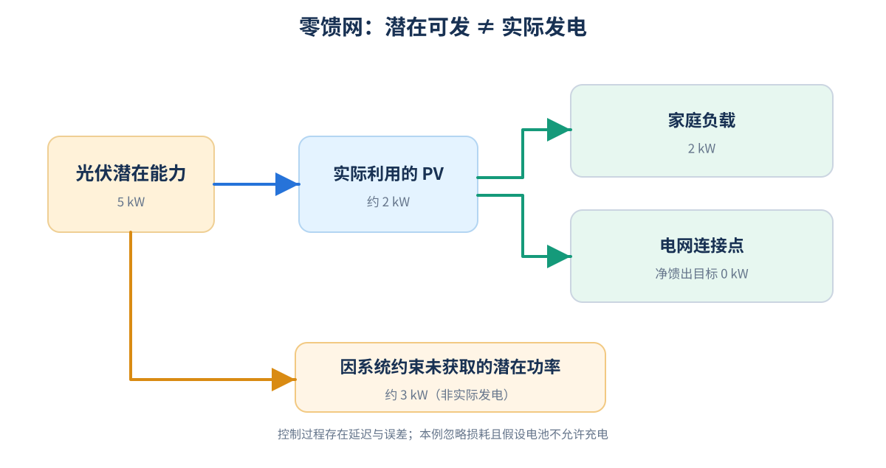

*图 4-2　理想化零馈网例子：限制电网连接点的净馈出功率，不等于关闭所有光伏发电。真实控制中测量、通信与执行有延迟，瞬时馈网并不保证绝对为零。*

零馈网是电网**连接点**的净功率目标，和“逆变器输出功率 = 0”完全不同。实现方式可能包括限 PV、控制电池充电或管理其他可用负载，取决于设备能力与策略优先级。

### 4.6 PV 5 kW，负载 2 kW，电池只充 1 kW

先假设所有功率已换算到同一个理想化无损边界：光伏 5 kW = 负载 2 kW + 电池充电 1 kW + 馈网 2 kW。

电池充电功率可能受 SOC、温度、BMS 允许充电电流/功率、电池电压、逆变器充电能力、用户策略及保护状态限制。即使光伏存在剩余功率，也不能认为电池一定能吸收全部功率；剩余电能可能馈网，若不允许馈网，则可能限发。

**重要口径提醒**：这个等式演示能量分配。真实 DC 耦合系统中，PV DC 输入、电池端充电和 AC 负载位于不同测量边界，需要纳入转换损耗；不可简单作为设备验收中的精确等式。

### 4.7 微逆没有电池字段：物理不存在还是数据缺失

某类微逆接口假设返回：

```json
{
  "pvPower": 1800,
  "gridPower": null,
  "batteryPower": null,
  "batterySOC": null
}
```

如果接口定义 `pvPower` 单位 W，则有效的 1800 表示 1.8 kW。其余 `null` 并**不能证明对应物理功率为 0**。

必须区分两种情况：① 系统未安装相关电表或电池，字段在拓扑上不适用；② 安装了设备，但当前没有有效数据。第一种情况可根据**已确认的物理拓扑**不展示无关节点；第二种情况应反映数据不可用，不能将设备当成不存在。

即使曾经上报 `batterySOC = 55`，也还需判断该值是否实时、对应哪台设备、设备是否仍安装并可参与工作。

### 4.8 夜间 PV = 0，但设备依旧在线

夜间没有有效太阳资源时，PV 发电通常为零，但逆变器、网关或通讯模块可能由电网、电池或其他电源供电并继续上报数据。反之，设备通信中断也不能证明现场发电停止。

因此：**设备在线 ≠ 正在发电；光伏为 0 ≠ 设备离线；数据未更新 ≠ 当前物理功率为 0**。夜间出现极小的非零值时还应核实传感器偏差、最小分辨率、上报延时与字段语义。

### 4.9 APP 突然显示 PV 从 3.2 kW 降为 0

| 观察到的现象 | 潜在原因 | 优先核实 |
|---|---|---|
| PV 电压有效、PV 电流为 0 | 未取电、待机、策略停止或保护 | 运行状态、MPPT 和限制状态 |
| PV1 正常、PV2 为 0 | 第二路未配置、遮挡、组串/输入异常 | 真实组串拓扑、端口状态和时间 |
| 所有实时数据同时停止更新 | 通讯链路或采集故障 | 时间戳、设备在线情况、网关状态 |
| 功率下降后迅速恢复 | 云层、短时控制或保护 | 天气、运行事件、告警和历史趋势 |
| 持续出现固定上限平台 | 削峰、限发或降额 | 额定参数、功率限制来源 |

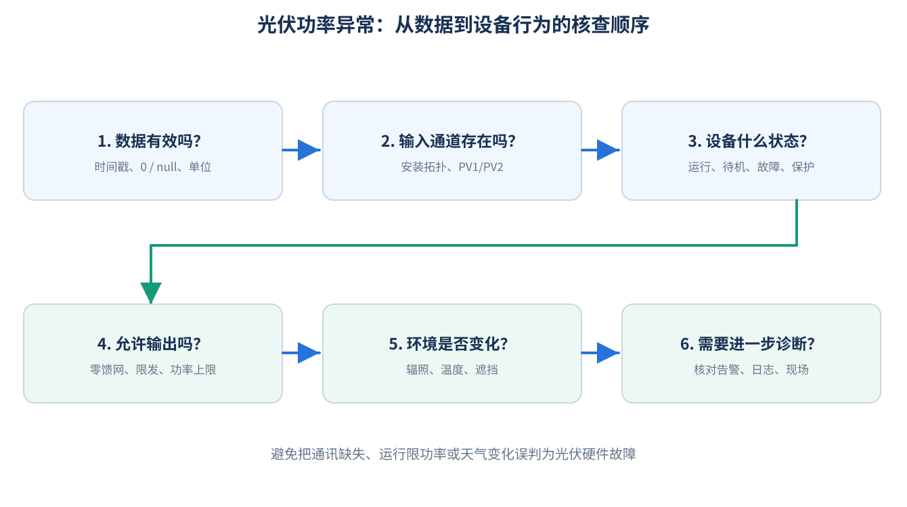

*图 4-3　产品层面的技术排查顺序。它用于避免错误归因，不代替电气故障诊断和专业检修。*

处理顺序应优先判断：**数据是否有效且新鲜 → 当前设备/输入实际存在吗 → 设备是什么运行状态 → 允许哪些能量通道工作 → 环境是否变化 → 是否需要进一步专业诊断**。

---

## 五、易混淆点与知识关联

### 5.1 关键概念对照

| 容易混淆 | 应当如何区分 |
|---|---|
| kW / kWh | 实时能量转换速率 / 累计能量 |
| kW / kWp | 一般功率 / STC 下标称峰值功率 |
| Voc / Vmp | 开路端电压 / 最大功率点电压 |
| Isc / Imp | 短路电流 / 最大功率点工作电流 |
| PV DC 功率 / 逆变 AC 功率 | 不同测量点，存在转换损耗和其他能量通道 |
| MPPT / 逆变器 | 最大功率点控制功能 / 电能转换设备 |
| 多个 PV 端口 / 多个 MPPT | 端口数量与独立控制通道数不一定相等 |
| 组件效率 / 逆变效率 / PR | 光电转换比例 / 电力转换比例 / 整体发电表现 |
| 限发 / 降额 / 故障 | 运行策略约束 / 设备可用能力下降 / 检测到异常 |
| 并网 / 馈网 | 与电网连接运行 / 向电网输出净功率 |
| 0 / null / 不支持 / 离线 | 有效零值 / 未知缺失 / 能力不存在 / 通讯不可达 |

### 5.2 组串参数与逆变器输入匹配

设备选配时，应核实：**最低预期电池片温度下组串 Voc 不超过最大允许 DC 输入电压**；正常工作条件下组串 Vmp 满足 MPPT 范围；工作和短路电流符合输入要求；组件数量、并联支路与额定接入容量符合设备手册。

晶硅组件在低温下 Voc 通常会上升。10 块 STC Voc = 50 V 的组件串联，其 STC Voc 为 500 V；寒冷环境下可能**大于 500 V**。具体校核须使用组件 Voc 温度系数、设计最低温度及设备允许值，不能仅用 STC 简单比较。

### 5.3 光伏与储能：增加利用率不等于增加太阳能

储能将部分电量从白天转移到其他时段使用，有机会提升自发自用或吸收原本被限制的光伏潜在发电，但不会凭空产生更多太阳辐射。电池充放电有损失：充入 5 kWh 不代表之后能向负载释放满 5 kWh。若电池允许电网充电，还需区分电池能量来源，才能合理解释“光伏贡献”。

### 5.4 光伏与电网：逆变器输出不等于并网点馈出

例如光伏逆变器 AC 输出为 4 kW、家庭消耗 3 kW、无储能也无其他能量源，忽略损耗时并网点馈出约 1 kW。**限制逆变器最大输出功率**与**限制并网点净馈出功率**的测量点、控制逻辑和用户结果都可能不同。

常见电网相关控制概念还包括有功功率限制、功率因数与无功管理、电压频率响应和外部调度，具体允许的行为以市场规则和设备支持能力为准。

### 5.5 光伏与物模型：字段名不能替代语义定义

常见字段：`PV1Voltage`、`PV1Current`、`PV1Power`、`TotalPVPower`、`DailyYield`、`TotalYield`、`MPPTStatus` 等。产品经理需要问清：

- 读数来源是设备自测、外部表计、云端汇总还是算法估算？
- PV1 对应的是端口、MPPT 还是组串？`TotalPVPower` 是否已包含 PV1、PV2？
- 单位 W、kW、Wh、kWh 是否统一？精度、缩放比例、符号约定怎样？
- 时间戳与数据新鲜度怎样？计数器是否会跨日、重启或换机重置？
- 机型不同、物模型不同、字段为空时，意味着什么？

本模块不推断任何 HaierEnergy 或青络 IoT 的真实字段映射，需以现场项目文件核实。

### 5.6 光伏与 HEMS 能流图：物理拓扑、功率状态和显示逻辑

需要把三个层次分开：

1. **安装与能力拓扑**：真正存在什么设备、哪个端口连接什么；
2. **实时能量状态**：哪些功率有有效值、方向和大小如何；
3. **产品展示归因**：按哪套规则解释净功率、源与负载的逻辑连接。

实体电池存在但电池功率为零，不代表电池不存在；系统没有电池但接口预留 `batteryPower` 字段，也不代表必须展示电池节点。在共用母线中，“PV→Load”的可视化路径可能是按净值和规则进行的逻辑分配，不一定是一条独立的物理电缆。

因此，做 HEMS 相关判断时应始终同时审查**拓扑、实时数值有效性、功率守恒、用户/设备策略**。

---

## 六、重点索引与参考资料

### 6.1 术语索引

| 术语 | 英文 / 缩写 | 一句话理解 |
|---|---|---|
| 光伏 | PV | 把光能直接转成电能 |
| 标准测试条件 | STC | 用于比较铭牌额定性能的规定测试条件 |
| 峰值瓦特 | Wp/kWp | STC 下的标称组件功率 |
| 辐照度 | Irradiance | 单位面积瞬时太阳辐射功率，W/m² |
| 组件平面辐照度 | POA | 面向组件倾斜平面的辐照度 |
| 开路电压 | Voc | I = 0 时端口电压 |
| 短路电流 | Isc | U ≈ 0 时端口电流 |
| 最大功率点 | MPP | U×I 最大的工作点 |
| 跟踪控制 | MPPT | 调整工作点尽量获取可用最大功率 |
| 光伏组串 | String | 多组件串联构成的回路 |
| 光伏阵列 | Array | 组串组成的集合 |
| 直流/交流耦合 | DC/AC Coupling | PV 与电池汇合的电能通道侧不同 |
| 削峰 | Clipping | 转换能力不足以利用全部潜在功率 |
| 降额 | Derating | 运行条件使允许输出上限降低 |
| 性能比 | PR | 系统实际发电相对于参考潜力的表现 |
| 荷电状态 | SOC | 当前电池电量状态的百分比估计 |
| 馈网 | Export | 电能从用户系统流向公共电网 |
| 零馈网 | Zero Export | 目标是限制并网连接点的净馈出功率 |

### 6.2 必须掌握的基础计算

| 公式 | 用途 | 成立条件与限制 |
|---|---|---|
| `P = U × I` | 直流功率 | 同一工作点；U 为 V，I 为 A，P 为 W |
| `E = P × t` | 电量 | P 为恒定或区间平均的 kW，t 为 h，E 为 kWh |
| `Pmax = Vmp × Imp` | 最大功率点 | 相同测试条件下的配对参数 |
| `ΣP_PVi` | 汇总光伏功率 | 时间同步、同一边界、无重复 |
| `η = P_out / P_in` | 效率 | 计量边界与能量通道一致 |
| `DC/AC = P_DC,rated / P_AC,rated` | 容量配比 | 两端额定量定义明确 |
| `E日 ≈ P_STC × H × PR` | 日发电估算 | 组件平面日辐照、PR 损失口径一致 |
| `P_PV,AC + P_Bat,AC + P_Grid = P_Load` | 简化 AC 母线平衡 | 放电与购电为正，充电与馈网为负；无其他通道且忽略损耗 |

### 6.3 理解即可的近似关系

- **辐照影响**：`P ≈ P_STC × G / 1000`，同温、同工作条件的粗略近似；G 单位 W/m²。
- **温度影响**：`P(T) ≈ P_STC × [1 + γ(Tcell − 25)]`，γ 是 1/°C，必须以相同辐照条件为基准。
- **等效利用小时**：`周期发电量（kWh） / 选定额定功率（kW）`，比较前统一分母采用 DC 还是 AC。

复杂半导体和变流器设计公式不属于本模块的产品经理必学范畴；需要时可进一步查阅权威技术资料。

### 6.4 官方资料及适用范围

以下链接为原始官方资料或标准目录页。标准目录页**不等于已获得标准全文许可**；涉及市场准入或验收时，应确认具体国家/地区实施要求与适用版本。

1. **美国能源部 DOE — Solar Photovoltaic Technology Basics**：光伏组件、阵列与系统整体，[官方链接](https://www.energy.gov/cmei/systems/solar-photovoltaic-technology-basics)。
2. **美国能源部 DOE — Solar Photovoltaic Cell Basics**：半导体与光伏效应，[官方链接](https://www.energy.gov/cmei/systems/solar-photovoltaic-cell-basics)。
3. **美国能源部 DOE — Solar Photovoltaic Performance and Efficiency Basics**：转换效率、温度、光学损失，[官方链接](https://www.energy.gov/cmei/systems/solar-photovoltaic-performance-and-efficiency-basics)。
4. **美国国家实验室（NLR）— PVWatts Version 8 API**：发电量估算模型、容量、天气及损失输入，[官方链接](https://developer.nlr.gov/docs/solar/pvwatts/v8/)，2026-10-10 核查时 V8 为现行 API 版本。
5. **IEC 61215-1:2021** — *Terrestrial photovoltaic (PV) modules — Design qualification and type approval — Part 1: Test requirements*。光伏组件设计鉴定与定型测试要求；测试结果**不直接预测定量寿命**，[IEC 官方页面](https://webstore.iec.ch/en/publication/61345)。本资料采用 **2021 版**，而非先前预览中的 2016 版。
6. **IEC 61730-1:2023** — *Photovoltaic (PV) module safety qualification — Part 1: Requirements for construction*。组件安全结构要求，不能替代全部国家/地区法规，[IEC 官方页面](https://webstore.iec.ch/en/publication/59803)。
7. **IEC 62109-1:2010** — *Safety of power converters for use in photovoltaic power systems — Part 1: General requirements*。光伏电力转换设备的通用安全框架，[IEC 官方页面](https://webstore.iec.ch/en/publication/6470)。截至 2026-10-10，IEC 网站也列有 **IEC 62109-1:2026 PRV 预发布版本**，其表明正式版本仍处于预发布/投票阶段，**不能把 PRV 当成所有市场已经生效的正式版本**，[预发布页面](https://webstore.iec.ch/en/publication/116681)。
8. **IEC 62446-1:2016+A1:2018** — 并网光伏系统的文档、调试测试与检查相关要求，[IEC 官方目录页](https://webstore.iec.ch/en/publication/63726)。各国家或地区采用版本在使用前应再次核实。

> **标准引用边界**：IEC 文本更新、修订或国家采标可能改变适用要求。以上“版本”只是本资料核查时的具体版本说明，不构成任何设备或项目的合规结论。实际逆变器参数必须以其官方规格书为准。

### 6.5 如何使用参考资料

按“**公开原理 → 设备规格 → 项目实现**”逐层核查：DOE/NLR 用于掌握机理和估算；组件及逆变器手册用于确定 Voc、Isc、MPPT、输出上限与保护功能；项目物模型、接口、日志与现场配置用于确认 HEMS 实际可观测的数据及能力。**原理上能够实现的功能，不代表某具体机型已经开放对应远程指令。**

---

## 七、本模块总结

### 7.1 最重要的主线

**太阳辐射决定潜在能源输入；组件决定电能转换能力；MPPT 选择可利用工作点；逆变器和其他能量通道决定实际转换能力；电网条件与系统策略决定最终如何分配和限制。**

所以“光伏功率”并不是只由太阳强度确定的一个数字，而是**自然条件、物理器件、电力转换、控制策略与测量边界**共同作用后的结果。

### 7.2 六个核心结论

1. **装机容量不等于实时功率**：kWp 是 STC 铭牌能力，kW 是具体时刻的测量或输出。
2. **有电压不等于发电**：还要有有效电流和功率传输通道。
3. **MPPT 在约束内优化取电**：不能突破安全边界，也不能创造更多太阳能。
4. **实际输出可能小于潜在能力**：温度降额、削峰、零馈网、调度限发和保护均可能发生。
5. **发电量不等于用户自用电量**：负载、电池和电网之间的分配需要明确边界与归因规则。
6. **HEMS 数据必须能够解释**：测量位置、方向、单位、时间、新鲜度、0/null 与设备能力均重要。

### 7.3 面向 HEMS 产品经理的知识框架

| 技术主题 | 应具备的实际判断能力 |
|---|---|
| 光伏物理原理 | 能解释光照、温度对电压、电流、功率的影响 |
| 组件、组串与阵列 | 能理解串并联及多 PV 通道差异 |
| 最大功率点 | 能解释 MPPT、遮挡及运行边界 |
| 光照与环境 | 能初步区分天气影响与可能的设备异常 |
| 逆变器 | 能区分 DC 输入、AC 输出、额定能力和降额 |
| 电网与控制 | 能解释零馈网、削峰、限发和保护停机 |
| 功率与电量 | 能检查基础计算及同口径功率平衡 |
| IoT/物模型 | 能区分有效 0、null、不支持、离线与旧数据 |
| HEMS 能流 | 能结合安装拓扑、实时状态与策略解释能源关系 |

学完本模块，应能够在讨论光伏功率异常、限发、储能充电、能流图和数据口径时，基于物理逻辑提出清晰的解释与核查方向，而不将正常运行策略误判为硬件故障。
